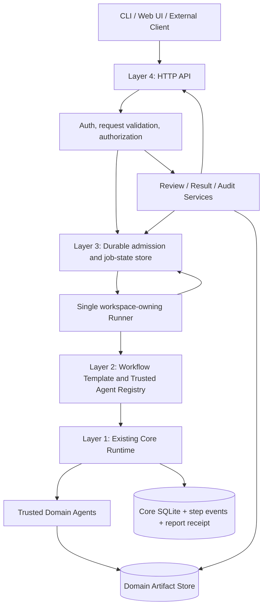

# System Neuron Flow AI — Architecture Review & Revised Architecture v2

**Review date:** 31 October 2026  
**Status:** Proposed architecture only — no repository code changes in this review  
**Repository:** `narongdetpyou-ux/System_Neuron_flow_AI`  
**Reviewed revision:** `09100f7e1c60dd991915626e27a37b5fb18303a6` (`main`)  
**Reference:** User-provided proposal, “Core Runtime + Domain Workflows + API Layer + Product Operations” (519 lines)

## 1. Executive decision

Retain the proposed **four-layer architecture**, but redesign how application services interact with the existing single-controller Runtime. The first useful target is a **single-machine, single-tenant workflow platform** for one concrete domain (suggested pilot: support-case triage). Do not implement multi-tenancy, distributed workers, Redis, PostgreSQL, or a large dashboard until the basic workflow and failure recovery have been verified.

The primary change is: **the HTTP API must not own or run the Core Runtime.** The API records admitted work, and a separate **single workspace-owning Runner** opens `Runtime`, calls `submit` and `run`, and persists the final application-level state. This avoids fighting the existing `WorkspaceLock` implementation.

## 2. Verified observations: current code versus the proposal

| Topic | Verified code | Architectural consequence |
|---|---|---|
| Domain remnant | `Soma._collect` still maps `csv_validate`, `csv_calculate` and `csv_verify` to telemetry phase names. | Remove the CSV-specific mapping or replace it with agent metadata; this is the one clear remaining finance/document-era hardcoding in Core that the scan found. |
| Runtime ownership | `Runtime.__init__` takes `WorkspaceLock(workspace/runtime.lock)`. | One active controller per workspace; API cannot independently instantiate the same Runtime while the Runner owns it. |
| Scheduling | `Soma.run(job_id)` executes a complete DAG in a blocking loop; it owns child workers and retry handling. | Keep scheduling, retries, and step dependencies in Core. Add a separate application-level durable queue and job admission. |
| Core step states | `PENDING`, `RUNNING`, `RETRY_WAIT`, `SUCCEEDED`, `FAILED`, `BLOCKED`; delivery may become `DELIVERY_FAILED`. | No native `WAITING_REVIEW` / pause-and-resume interface. Build review across two linked workflows first. |
| Core contracts | JSON-only; `MAX_MESSAGE_BYTES = 1,048,576`; up to 1,000 steps; `max_attempts` between 1 and 5. | Store larger files outside the step message. Pass bounded artifact references and hashes through a validated resolver. |
| Agent registration | `AgentDefinition(name, entrypoint, validator, version)`; validator is executed after result. | Domain package controls trusted registry; user requests never provide executable import paths. |
| Job identity | Core `Store.submit` rejects the same `job_id` bound to different spec fingerprints. | Distinguish application request idempotency from Core job identity, and maintain a durable mapping. |
| Recovery | Core recovers interrupted running steps when job resumes, counting interrupted attempts. | The runner should reconcile queue state and Core state after process death; do not promise exactly-once external effects. |
| Event stream | SQLite events with recipient filtering; Core `events_for` returns all records after cursor, without an API page size parameter. | Add a bounded read-model/pagination adapter for public API; do not expose Core `Store` wholesale. |
| Report | `AxonTerminal` writes a JSON file and verifies it with SHA-256. | Create a separate domain artifact store for larger attachments; Core receipt is metadata, not a universal artifact interface. |
| Integrity | `verify_manifest` compares bytes against a supplied manifest; the source itself says there is no authorship authentication. | Add identity-bound review decisions, authorization and an application audit ledger; checksums alone are not tamper-evident provenance. |
| Case memory | `CaseMemory` requires exactly six profile dimensions, caller-supplied review evidence, and trains only on `train` split. | Treat it as an optional evidence/retrieval capability, not a domain-general learning engine or automatic decision maker. |
| Evaluation | `candidate_gate` compares provided case outcomes and supplied latency/attempt metrics. | The gate is a regression detector on declared evidence; correctness requires independent ground-truth evaluation. |
| Existing tests | The extracted repo contains five focused core tests. | Keep them, but add admission, crash recovery, idempotency, review, safety and integration tests before claiming platform readiness. |

Code evidence: [Runtime/Engine](https://github.com/narongdetpyou-ux/System_Neuron_flow_AI/blob/09100f7e1c60dd991915626e27a37b5fb18303a6/neuron_flow/engine.py), [Model](https://github.com/narongdetpyou-ux/System_Neuron_flow_AI/blob/09100f7e1c60dd991915626e27a37b5fb18303a6/neuron_flow/model.py), [Storage](https://github.com/narongdetpyou-ux/System_Neuron_flow_AI/blob/09100f7e1c60dd991915626e27a37b5fb18303a6/neuron_flow/storage.py), [Integrity](https://github.com/narongdetpyou-ux/System_Neuron_flow_AI/blob/09100f7e1c60dd991915626e27a37b5fb18303a6/neuron_flow/integrity.py), [Case Memory](https://github.com/narongdetpyou-ux/System_Neuron_flow_AI/blob/09100f7e1c60dd991915626e27a37b5fb18303a6/neuron_flow/case_memory.py), [Evaluation](https://github.com/narongdetpyou-ux/System_Neuron_flow_AI/blob/09100f7e1c60dd991915626e27a37b5fb18303a6/neuron_flow/evaluation.py).

## 3. Revised four-layer architecture



**Layer 1 — Core Runtime (existing `neuron_flow/`)**  
Responsibilities: strict spec normalization, DAG validation, bounded workers, error classification, timeouts, retries, step state, job recovery, targeted events, local JSON receipt, integrity primitives. **No HTTP, business policies, PDF/OCR, external service credentials, or user authorization.** The optional `case_memory` and `evaluation` modules may remain physically in this package for now but should be accessed through explicit adapters, not assumed mandatory for every workflow.

**Layer 2 — Domain packages and trusted agents (`app/domains/`)**  
Responsibilities: domain input schema, template versioning, mapping of declared workflow types to step graphs, whitelisted agent registration, output validators, domain-specific extraction/classification/rules. Start with *one* domain, e.g. `case_triage.v1`, which can run with deterministic stub agents before introducing LLMs. A domain workflow **builds a spec**; it never reimplements Core retries, dependency scheduling or multiprocessing.

**Layer 3 — Application services (`app/services/`, `app/persistence/`)**  
Responsibilities: durable admission queue, request-level idempotency, runner ownership and reconciliation, review decision ledger, job/result projection, artifact indexing, outbound effects and notifications (later). The Runner is the **only** layer that opens Core Runtime for a workspace. Use a single SQLite-backed application queue in the first version, with one runner. Two SQLite databases are acceptable, but cross-database state changes are *not atomic*: reconcile them explicitly after crashes.

**Layer 4 — Interfaces (`app/api/`, optional `app/ui/`)**  
Responsibilities: authenticate/authorize, validate body, return accepted job ID, read job summaries and event pages, receive human decisions. HTTP request handlers must **not** wait for a long-running `Runtime.run()` call. The CLI can invoke the same application service contracts without adding another orchestration implementation.

**Cross-cutting concerns:** configuration, security, audit, telemetry, and artifact provenance. They are capabilities spanning layers, not an excuse to allow business-specific logic into Core.

### Dependency rule

`Interface → Application Services → Domain Template/Registry → Core Runtime`. Runtime invokes registered agent entrypoints, but **Core source files must never import `app.*`**, and a domain must not mutate Core SQLite directly. Any worker access to secrets or files must be narrowly scoped.

## 4. First executable lifecycle

1. `POST /v1/jobs` validates authentication, workflow type and domain input; server assigns a unique `job_id` and binds `idempotency_key + request fingerprint` in the application SQLite queue. Reply `202 Accepted` with `QUEUED` status.
2. A **single** Runner claims the work (atomic claim under a single-machine lock/lease strategy), resolves the trusted workflow template and agent registry, opens `Runtime(workspace, agents=...)`, then invokes `submit(spec)` and `run(job_id)`.
3. Core executes a static DAG, saves events/steps, and emits a verified JSON report receipt. Runner reconciles the Core snapshot into the application job projection.
4. If the domain result requires approval, the **application** marks the request `REVIEW_REQUIRED`. This is an application status; the corresponding Core phase-A workflow has already finished successfully. Do not create an agent that simply blocks until a person acts.
5. An authenticated reviewer sends an explicit, versioned decision with reviewer ID, timestamp, reason, previous artifact hash and decision hash. An approved decision creates a **new linked phase-B job** with its own immutable workflow spec. Reject decisions end at `REJECTED` without invoking phase B.
6. The API reads application projections for `GET /v1/jobs/{job_id}` and queries a bounded event adapter. Large documents and other binary files live in the domain artifact store, with content digest and access controls.
7. After a runner restart, reconcile all `RUNNING`/claimed work against Core state and receipt; do not submit a different spec with an existing Core `job_id`; do not restart an irreversible external write without an idempotency policy.

Application states for the first implementation: `QUEUED → RUNNING → COMPLETED | REVIEW_REQUIRED | FAILED | DELIVERY_FAILED`; review-specific `REVIEW_REQUIRED → APPROVED → (linked phase-B QUEUED)`, or `REJECTED`. `APPROVED` is a review decision, **not** proof of Core execution success. Define exact mapping rules from Core states to Application states in one versioned adapter.

## 5. Proposed API contract (design, not implemented)

**POST `/v1/jobs`**

```json
{
  "workflow_type": "case_triage.v1",
  "idempotency_key": "client-request-001",
  "input": {"case_id":"T-001","summary":"Unable to upload an attachment"}
}
```

**Response `202`:**

```json
{"job_id":"job_001","status":"QUEUED","workflow_type":"case_triage.v1"}
```

**GET `/v1/jobs/{job_id}`** returns stable application status, core job mapping, review summary, result digest and safe links—never raw internal paths or credentials.  
**GET `/v1/jobs/{job_id}/events?after=<cursor>&limit=100`** returns bounded events and next cursor.  
**POST `/v1/reviews/{review_id}/decisions`** accepts `APPROVE`/`REJECT`, reviewer identity obtained from authenticated session, decision reason and expected review version (optimistic concurrency).  
**GET `/v1/artifacts/{artifact_id}`** authorizes access and resolves a content-addressed file; it never uses a user-supplied filesystem path directly.

The initial application does **not** accept arbitrary `agent` import paths, arbitrary Python code, `tenant_id`, or untrusted callbacks in API inputs.

## 6. Minimal code organization to implement first

```text
System_Neuron_flow_AI/
  neuron_flow/                      # Existing Core Runtime; unchanged unless tests expose defects
    engine.py model.py storage.py supervision.py integrity.py
    telemetry.py case_memory.py evaluation.py
  app/
    api/
      main.py                      # Thin HTTP handlers
      jobs.py
      reviews.py
    services/
      admission.py                 # Idempotency and request validation
      runner.py                    # Sole Runtime owner
      reconciliation.py           # Recovery across two persistence boundaries
      review.py                    # Approval/rejection and linked jobs
      results.py                   # Read projections
    persistence/
      queue_store.py               # Durable SQLite queue + claim ownership
      review_store.py              # Authenticated decisions + optimistic concurrency
      artifact_store.py            # Atomic write, SHA-256, safe readback
    domains/
      registry.py                  # Trusted factories, workflow-to-agent mapping
      case_triage/
        contracts.py
        workflow.py
        agents.py
  tests/
    test_core.py                   # Existing tests retained
    test_admission.py
    test_runner_recovery.py
    test_review.py
    test_api.py
    test_artifact_integrity.py
  docs/
    architecture.md
    contracts.md
    failure_recovery.md
  pyproject.toml
  README.md
```

Do **not** create `db/migrations/`, `storage/*`, `observability/*`, `docker/*` and multiple overlapping registry implementations until a first vertical slice needs them. Avoid duplicating `App WorkflowService` and the Core `Soma` scheduler.

## 7. Architecture decisions (ADRs)

- **ADR-001 — One controller per workspace.** Only the Runner instantiates Runtime; API never holds `runtime.lock`.
- **ADR-002 — Durable admission before execution.** Respond `202` only after the idempotency binding and queued job are committed to application storage.
- **ADR-003 — Single-machine deployment first.** One Runner with existing bounded child processes; multi-process serving, Redis, PostgreSQL and distributed claims are out of scope.
- **ADR-004 — Two-phase human review.** Review approval is external to Core. A separate version-bound phase-B job resumes the business process logically; Core does not pretend to pause a running process.
- **ADR-005 — Trusted agents only.** Explicit registry. Validators, agent versions and workflow-template versions are frozen for each job. Never treat an import path or metadata supplied by an end user as executable authority.
- **ADR-006 — Separate large artifacts.** Core JSON wire stays within 1 MiB; domain files use digests and a controlled Artifact Store. Do not infer a file is safe merely because its hash is correct.
- **ADR-007 — Side effects are not automatically exactly-once.** For webhooks, payments, external writes, etc., use effect-specific idempotency keys, durable outbox or reconciliation. Core retry guarantees are execution-level only.
- **ADR-008 — Honest audit claims.** SQLite event records and hashes support traceability but do not independently prove reviewer authenticity, immutability against a privileged writer or completeness after malicious modification.
- **ADR-009 — CaseMemory and candidate_gate are optional.** No automatic policy promotion from similarity; no accuracy claims from paired declared outcomes alone.

## 8. Acceptance gates before expanding scope

**P0 — Required before first usable API release**

1. Concurrent identical request keys yield the same job; a mismatched payload with that key returns a conflict and does not create a second execution.
2. HTTP admission remains responsive while a job executes; only one Runner obtains the workspace lock.
3. Kill the Runner during a step and restart; application state reconciles with Core, respecting the step's existing retry budget.
4. Invalid workflow/unknown agent/oversized JSON returns a deterministic validation error before executing any agent.
5. A wrong output validator marks the step failed and blocks only dependent steps, not independent branches.
6. Phase-A case review can be approved/rejected exactly once per review version; unauthorized review is denied; approval creates one linked phase-B job, not an in-place Core restart.
7. A repeated or interrupted delivery does not overwrite a different report; delivery conflicts surface as distinct status.
8. An external side-effect agent cannot be blindly retried without an idempotency contract.
9. Hash verification detects changed artifacts and API cannot expose unapproved workspace files. Test the race between report preflight and file publication under the single-owner assumption.
10. Tests run on supported Python versions (3.10, 3.12), with real subprocess crash/timeout coverage and no regression to the extracted Core tests.

**P1 — After the vertical slice is green:** replace CSV-specific telemetry naming in `Soma._collect` with domain-neutral phase labels or registered agent metadata; bounded event pagination, phase metrics, retention/pruning, backup/restore exercise, structured log correlation IDs, integration adapter contracts, API authentication hardening, explicit cancellation behavior.

**P2 — Future decisions (do not implement preemptively):** multi-tenancy, scalable worker queues, distributed locking, Postgres, object storage, production SLAs, hosted dashboard, full domain-driven plug-in ecosystem.

## 9. Suggested delivery sequence

**Milestone A — Contract and domain proof:** create one `case_triage.v1` template and trusted Agent Registry, with tests and no public API. Demonstrate it runs through existing Core without editing Core internals.  
**Milestone B — Application lifecycle:** durable queue, idempotency mapping, single Runner and restart reconciliation; add thin jobs API.  
**Milestone C — Review and evidence:** two-phase review, authenticated decision ledger, linked phase-B workflow and artifact references.  
**Milestone D — Operability:** pagination, metrics, integration tests, backup exercises, deployment packaging.  
**Milestone E — Another domain:** add a second unrelated workflow only after proving it requires **zero** changes to Core; then consider external connectors/UI.

## 10. Out-of-scope and caveats

This is a proposed architecture based on static code inspection and existing lightweight unit tests. It is **not** an implementation, security assessment, validated production design, or live performance benchmark. No code in `System_Neuron_flow_AI` was changed by this review. The underlying Runtime is intentionally single-machine, its worker isolation is not an untrusted-code security sandbox, and its retry model alone does not make external side effects safe.