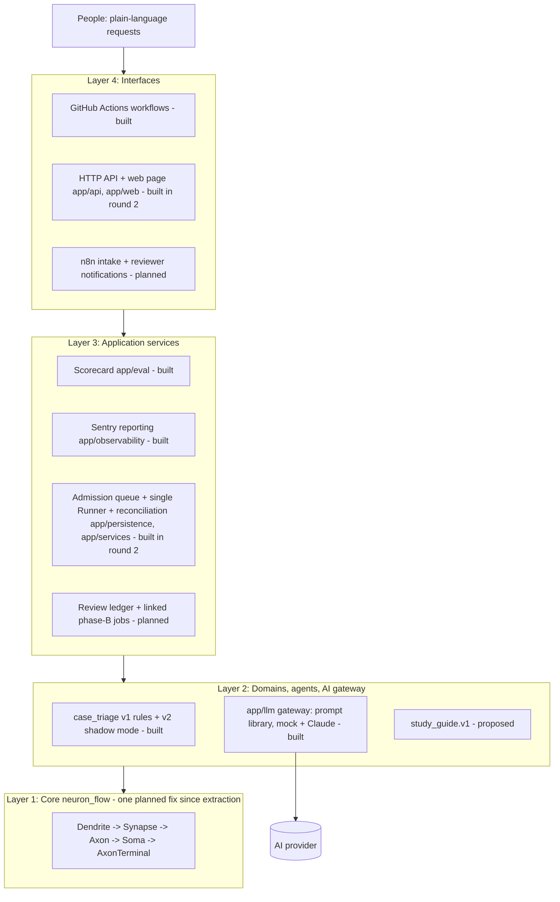

# System Neuron Flow AI — Architecture

**Current as of 2026-11-03** (`main` @ `0b03735`, after roadmap Phase 1 in PRs #21–#24; first written for
round 2, PR #11, on top of `59c6889`). This file replaces
"Architecture Review & Revised Architecture v2" (31 Oct 2026). That review's dated code observations were
re-checked against the current code and folded into §3. The AI design comes from the v3 roadmap, and its
round 1 is built (§4). Round 2 adds the intake API, the durable job queue, the single Runner with crash
reconciliation and a web page (§5, §6; details in [intake_queue.md](intake_queue.md)).

## 1. Design philosophy

Every decision below serves the owner's philosophy ([full text, mostly Thai](design_philosophy.md)):
- **Plain language outside, deep work inside.** Everyday and metaphorical language in; structured, checked,
  auditable work inside.
- **Understand, elaborate on request, stay inside the frame.** The frame is versioned data, and "out of scope"
  is a valid answer.
- **AI proposes, code verifies, people decide what matters.**
- **No perfectionism.** Small measured steps and honest uncertainty.
- **Equitable support without being asked.** When technology comes up, the first response offers study
  resources, what each one is for, and which topics to study first.

## 2. Four layers



| Layer | Responsibility | Built | Planned |
|---|---|---|---|
| 1 Core `neuron_flow/` | Spec validation, static DAG scheduling, bounded child processes, retries, recovery, events, verified receipts, integrity, case memory, candidate gate. No HTTP, business rules, credentials or user authorisation. | All of it; changed once since commit `09100f7`: the telemetry fix (roadmap 1.1, PR #21) | No further Core change planned |
| 2 Domains & agents `app/domains/`, `app/llm/` | Input contracts, trusted agent registry, fixed DAG templates, validators, AI calls | case_triage v1 and v2, AI gateway | `study_guide.v1`, a second unrelated domain |
| 3 Application services | Admission, idempotency, the only Runtime owner, crash reconciliation, review decisions, results, measurement, monitoring | Scorecard (`app/eval/`), Sentry reporting (`app/observability/`), admission queue (`app/persistence/`), admission, Runner with reconciliation, results (`app/services/`) | Review ledger, artifact store (Milestone C) |
| 4 Interfaces | Authentication, request validation, status pages, human decisions | GitHub Actions workflows (tests, scorecard, Sentry check, container check, manual Claude run); HTTP API and web page (`app/api/`, `app/web/`) behind one shared access key, started by `app/serve.py` in one container for Render (`render.yaml`; Railway also configured) | n8n intake and notifications, per-reviewer identity, review decisions |

**Dependency rule:** Interface → Services → Domain → Core. Core never imports `app.*`. A domain builds specs
and registers agents. It never re-implements retries or scheduling, and it never writes to Core SQLite.

## 3. Core constraints that shape every design

Each row was re-checked against the current code.

| Constraint in the code | Consequence for the design |
|---|---|
| `Runtime` holds `WorkspaceLock(workspace/runtime.lock)` | One controller per workspace. Only a single Runner may open it; an API must never hold the lock |
| `Soma.run(job_id)` runs a whole static DAG in a blocking loop | Durable admission and queueing belong to the application layer |
| Step states `PENDING, RUNNING, RETRY_WAIT, SUCCEEDED, FAILED, BLOCKED`; jobs may end `DELIVERY_FAILED`; no pause/resume | Human review is modelled as two linked jobs, not a paused one |
| JSON only, ≤ 1 MiB per message, ≤ 1000 steps, `max_attempts` 1–5 | Large files go to an artifact store and are passed by reference + hash |
| `AgentDefinition(name, entrypoint, validator, version)`; the version is frozen per job | Agents come from a trusted registry. The version carries AI provenance (§4) |
| Same `job_id` with a different spec is rejected | The application must map request idempotency keys to job ids |
| Interrupted `RUNNING` steps are retried and count against `max_attempts` | External side effects are not exactly-once; they need their own idempotency |
| `events_for` returns every event after a cursor, with no page size | A public API needs a bounded, paginated adapter |
| Receipts and manifests verify bytes with SHA-256 | Checksums do not prove who wrote something, so review identity needs authentication |
| Telemetry records each agent step under its own step id, next to Core's own phases `contract_validation` and `delivery` (fixed in PR #21; the legacy `csv_*` mapping is gone) | Step ids in the catalog must not reuse those two names; a test checks it |
| `CaseMemory` needs six profile dimensions and caller-declared review evidence; `candidate_gate` flags any changed outcome | These detect regressions; they are not accuracy proof and not automatic decision makers |

## 4. AI inside the architecture (built in round 1, PR #9)

- **The AI is a trusted Layer 2 agent, never the orchestrator.** Core still schedules, retries and records.
- **One gateway, `app/llm/`:**
  - The prompt and its answer schema live in one versioned file, and one SHA-256 covers both.
  - Answers use structured JSON output. Current Claude 5.5 models reject forced `tool_choice` and sampling
    parameters, so the client sends neither.
  - The client refuses HTTP redirects, so the key cannot travel to another host.
  - The API key is read from the environment at call time. It never appears in a job, an output or a log.
  - Personal data is masked before every call (`app/llm/redaction.py`, roadmap 7.1): the gateway accepts
    only text from `mask()`, the AI sees placeholders such as `[PHONE]`, and the AI step records how many
    items of each kind it masked. The masking version is part of the agent version.
- **The error class decides what Core does:**

  | Error | Examples | What happens |
  |---|---|---|
  | Transient | 408, 429, 5xx, timeouts, network | Retry |
  | Setup | 401, 403, 404 | Fail loudly |
  | Rejected request | other 4xx, redirects | Fail loudly |
  | Off-contract answer | broken JSON, unknown value, cut off | Retry, then "unavailable" |
  | Refusal | `stop_reason: refusal` | "unavailable" at once |

- **Validators check three things before Core saves any output:**
  - Schema: the fields and types are right.
  - Invariants: the queue matches the category, and the provenance matches the frozen job settings.
  - Policy: there is never an automatic decision.
- **Provenance:** the agent version is
  `llm=<provider>/<model>;prompt=<id>@sha256:<hash>;max_tokens=…;effort=…;redaction=<version>`. Changing the
  model, the prompt or the masking rules therefore creates a new version, and an old job refuses to run on it.
- **Shadow mode:** the rules stay official. The AI adds a second opinion, and a disagreement raises review to
  elevated. Every proposal stays `PENDING_HUMAN_REVIEW`.
- **Monitoring:** failed steps send Sentry errors; degraded steps (`{"status": "unavailable"}`) send grouped
  warnings.
- **Agent patterns for later:**
  - A: a bounded tool loop inside one step (preferred first).
  - B: a planner step that produces a plan, validated and run as a new linked job.
  - C: a dynamic DAG inside Core is **not** recommended.

## 5. Job lifecycle (steps 1–3 and 5 built in round 2; step 4 is Milestone C)

1. **Built.** `POST /v1/jobs` checks the access key and the input, assigns a `job_id`, and stores
   `idempotency_key` + request fingerprint in the application queue (`<data>/app/queue.sqlite3`). It replies
   `202 QUEUED` only after the commit.
2. **Built.** The single Runner claims the oldest job, freezes the exact Core spec in the queue *before*
   submitting it, then calls `submit` and `run` on its `Runtime(<data>/core, agents=…)`. It writes a
   path-free summary of the Core outcome back into the job record.
3. **Built.** A proposal that needs approval marks the job `REVIEW_REQUIRED`. The Core job itself has
   already finished.
4. *Milestone C.* An authenticated reviewer sends a versioned decision. **Approve** creates one linked
   phase-B job; **reject** ends at `REJECTED`.
5. **Built.** After a Runner restart, every job still `RUNNING` in the queue is reconciled with Core state,
   always with its frozen spec. A job whose spec would now be built differently (model, prompt or code
   changed) fails as `configuration_changed`; a job claimed `max_claims` times fails as
   `runner_attempts_exhausted`. A different spec is never submitted under an existing `job_id`.

Application states: `QUEUED → RUNNING → COMPLETED | REVIEW_REQUIRED | FAILED | DELIVERY_FAILED` and
`QUEUED → CANCELLED` (built; cancel only before the claim, roadmap 1.3), then
`REVIEW_REQUIRED → APPROVED → (linked phase-B QUEUED)` or `REJECTED` (Milestone C).

## 6. API contract

Built in round 2 (full reference in [intake_queue.md](intake_queue.md)):
- `POST /v1/jobs` with `{"workflow_type": "case_triage.v2", "idempotency_key": "…", "input": {"case_id": "…", "summary": "…"}}`
  replies `202 {"job_id": "…", "status": "QUEUED", …}`; the same key and request again replies `200` with the
  same job; the same key with another request replies `409`.
- `GET /v1/jobs/{job_id}` returns status, the step plan frozen at claim, the review summary, a step
  timeline, AI provenance and the receipt hash. It never returns internal paths, params or credentials.
- `GET /v1/jobs/{job_id}/events?after=<cursor>&limit=1-100` returns bounded pages.
- `POST /v1/jobs/{job_id}/cancel` withdraws a job that is still `QUEUED` (`409 not_cancellable` otherwise;
  repeating it on a cancelled job returns `200` with the same record).
- `GET /v1/jobs?limit=&before=` lists jobs newest first; `GET /v1/status` shows the Runner heartbeat, queue
  counts, queue and run-time figures (waiting count and oldest age; median and slowest wait and run times
  per workflow over the newest 100 finished jobs; failures by reason; roadmap 5.3), AI mode, storage and
  each workflow's steps (ids, agents, order, retry budget, time limit; never params); `GET /healthz` is the
  unauthenticated liveness check.
- Every response carries `X-Request-Id` (the client's id when it is safe to log, otherwise a new one). The
  same id ends the access log line and is stored in a new job's `job.queued` event (roadmap 1.2).

Planned (Milestone C):
- `POST /v1/reviews/{review_id}/decisions` takes `APPROVE`/`REJECT`, the reviewer from the authenticated
  session, a reason and the expected version.
- `GET /v1/artifacts/{artifact_id}` is authorised access by id, never by a user-supplied path.

Requests never carry agent import paths, code, tenant ids or callbacks.

## 7. Code organisation

```text
neuron_flow/                   Core runtime (one change since extraction: the telemetry fix)
app/domains/case_triage/       v1 rules (agents.py, workflow.py), contracts.py, v2 shadow_agents.py, shadow_workflow.py
app/llm/                       config, errors, gateway, prompts, redaction (personal-data masking), prompt_library/, providers/{mock, anthropic}
app/eval/                      triage_shadow_eval.py, golden/case_triage_synthetic_v1.json (61 cases)
app/observability/             sentry.py (step failures, degraded AI, Runner recoveries)
app/persistence/               queue_store.py: the application job queue, events and Runner heartbeat (SQLite)
app/services/                  workflows.py (catalog), admission.py, runner.py (with reconciliation), results.py, metrics.py
app/api/                       routes.py (ApiApp), server.py (standard-library HTTP server), limits.py
app/web/                       index.html, app.css, app.js: the Thai web page (chat layout, Flow and Trace, read-only settings)
app/boot.py                    process 1 of the image: takes the data folder, drops root, becomes tini
app/settings.py, app/serve.py  environment settings; the launcher (API + supervised Runner in one container)
Dockerfile, render.yaml        the container and the Render Blueprint (railway.json kept for Railway)
examples/                      case_triage_demo, case_triage_shadow_demo, sentry_smoke_test, service_smoke_test
tests/                         141 tests: core, triage v1/v2, AI gateway, masking, scorecard, eval gate, Sentry, API, queue, Runner, HTTP, metrics
tests/baselines/               shadow_eval_mock.json: every case's answer with the mock AI (the eval gate's baseline)
.github/workflows/             core-tests, service-container, secret-scan, sentry-smoke, shadow-eval-claude (manual)
.github/gitleaks.toml          secret scan rules (gitleaks defaults + Sentry DSN); .github/.gitleaksignore: reviewed findings
.github/scripts/               check_render_blueprint.py: render.yaml structure, build filter, Render's schema
planned: review ledger and artifact store, app/domains/study_guide/
```

## 8. Architecture decisions (ADRs)

| ADR | Decision | Status |
|---|---|---|
| 001 | One controller per workspace; only the Runner opens Runtime | In force; the API never opens it, and a second Runner fails with `WorkspaceBusy` |
| 002 | Durable admission before execution; reply 202 only after commit | In force |
| 003 | Single machine first; no Redis, Postgres or distributed claims | In force: SQLite queue on one disk |
| 004 | Two-phase human review as linked jobs | Accepted; Milestone C |
| 005 | Trusted agents only; versions frozen per job | In force |
| 006 | Large artifacts stay outside Core messages | Accepted; not needed yet |
| 007 | Side effects are not automatically exactly-once | In force; no side-effect agents exist yet |
| 008 | Honest audit claims; hashes prove bytes, not authorship | In force |
| 009 | CaseMemory and candidate_gate are optional regression tools | In force; the scorecard uses candidate_gate |
| 010 | In shadow mode the AI is advisory; rules stay official until measurements justify more | In force |
| 011 | The prompt and answer schema are one versioned file; its hash is part of agent identity | In force |
| 012 | Provider hiccups degrade gracefully; setup errors fail loudly | In force |
| 013 | Secrets come only from the environment at call time | In force; tested by scanning every stored file |
| 014 | API and Runner run in one container on one disk; the launcher supervises the Runner. A disk attaches to a single instance, so two Runners never share it. Host: Render (Railway paused new sign-ups on 22 Oct 2026) | In force (round 2) |
| 015 | Interrupted jobs resume only under the spec frozen at their first claim; any drift fails them as `configuration_changed` | In force (round 2) |
| 016 | Until reviewer identity exists (Milestone C), the API is protected by one shared access key, with per-client limits on wrong keys | In force (round 2); to be replaced |

## 9. Acceptance gates

**Met in round 1 (all automated):**
- AI shadow mode was added with **zero Core changes**.
- Changing the model or prompt stops an old job from re-running.
- Prompt injection (EN/TH) cannot pick a queue or make a decision.
- An AI outage still lets the case reach review.
- The API key is absent from every stored file.
- Redirects cannot carry the key elsewhere.
- Personal data that the masking rules recognise never reaches the provider (roadmap 7.1; tested with Thai
  and English samples against the fake Claude API).
- Tests pass on Python 3.10–3.13.

**P0 for the first API release, met in round 2 (automated; tests listed in [intake_queue.md](intake_queue.md)):**
- Concurrent identical requests produce one job, and a mismatched payload produces a conflict.
- Admission stays responsive while jobs run, and only one Runner holds the lock.
- Killing the Runner mid-step reconciles correctly within the retry budget.
- Invalid input is rejected before any agent runs.
- A failed validator blocks only the dependent steps.
- Delivery conflicts get their own status.
- The container runs without root, keeps its data across a restart and stops cleanly (CI container job).
  That job now runs without `CAP_KILL`, as Render does. Until `app/boot.py` (2026-11-01), process 1
  (tini) ran as root and could not pass SIGTERM on there, so stops on Render were not clean. On Render,
  stops have been graceful since then ([evidence](evidence/2026-11-03-render-operations.md)).

**P0 still open:**
- A review decision applies once per version, unauthorised reviews are denied, and approval creates exactly
  one phase-B job (Milestone C).
- Side-effect agents need an idempotency contract (none exist yet).
- Hash checks catch changed artifacts (no artifact store yet).

**P1:**
- Done: the telemetry phase fix (§3, PR #21); event pagination for the API (`limit` 1–100 with a cursor);
  correlation (request) ids in logs (PR #22); explicit cancellation of queued jobs (PR #23); queue and
  run-time figures on the status page (PR #26, ROADMAP 5.3); the eval gate in CI, which fails when any
  per-case answer of the mock scorecard changes (PR #27, ROADMAP 5.2); a secret scan of every commit of
  every branch in CI, with the Sentry DSN read only from a repository secret (PR #29, ROADMAP 7.4).
- Open: retention and backup/restore drills (1.4, needs a disk), API authentication hardening (2.1, 7.2).

**P2 (do not build early):** multi-tenancy, distributed workers, Postgres, object storage, SLAs, a hosted
dashboard.

## 10. Milestones

| Milestone | Content | Status |
|---|---|---|
| A | case_triage v1 rules, synthetic demo, tests | Done |
| A2 | AI gateway, v2 shadow mode, scorecard, Sentry reporting | Done (PR #8, #9); real Claude not yet run |
| P1-fix | Neutral telemetry phase names | Done (PR #21, roadmap 1.1) |
| B | Admission queue, single Runner, reconciliation, thin API, web page | Done (PR #11); live on Render's free plan since 2026-11-01; page redesigned as a chat layout with Flow, Trace and read-only settings (PR #18, roadmap 1.6) |
| C | Two-phase review, decision ledger, n8n notifications | Open |
| D | OpenTelemetry tracing, eval gates in CI | Partly done: CI scorecard with the per-case eval gate (5.2), Sentry, request ids and queue/run-time figures (5.3) exist; tracing is open |
| E | Planner pattern (B), MCP server, second domain with zero Core changes | Open |
| — | `study_guide.v1`: first-response study guide ([design_philosophy.md](design_philosophy.md)) | Proposed |

The order of the remaining work, with tasks, acceptance checks and owner decisions for each step, is in
[ROADMAP.md](ROADMAP.md).

## 11. Limits

- This is a single-machine runtime. Its child processes isolate failures; they are **not** a sandbox for
  untrusted code.
- The HTTP server is Python's standard-library server with request, connection and time limits. It suits a
  single-owner pilot, not public traffic. One shared access key is not per-person authentication.
- All data is synthetic, and mock-AI scores test the pipeline, not accuracy. Masking before AI calls is
  pattern-based and misses names without a title, addresses and more, so it does not make real data safe.
- Every process in the container (API, Runner, Core workers) runs as one user with one environment, so each
  of them could read the AI key once it is set. Options and a recommendation are in ROADMAP 7.1.
- The Sentry DSN that the smoke workflow carried until 2026-11-03 is still in the git history. It can only
  submit events; it must be revoked in Sentry before the repository is made public (ROADMAP 7.4).
- Live Claude results, security review, benchmarks and user studies do not exist yet. No document should
  claim them.
