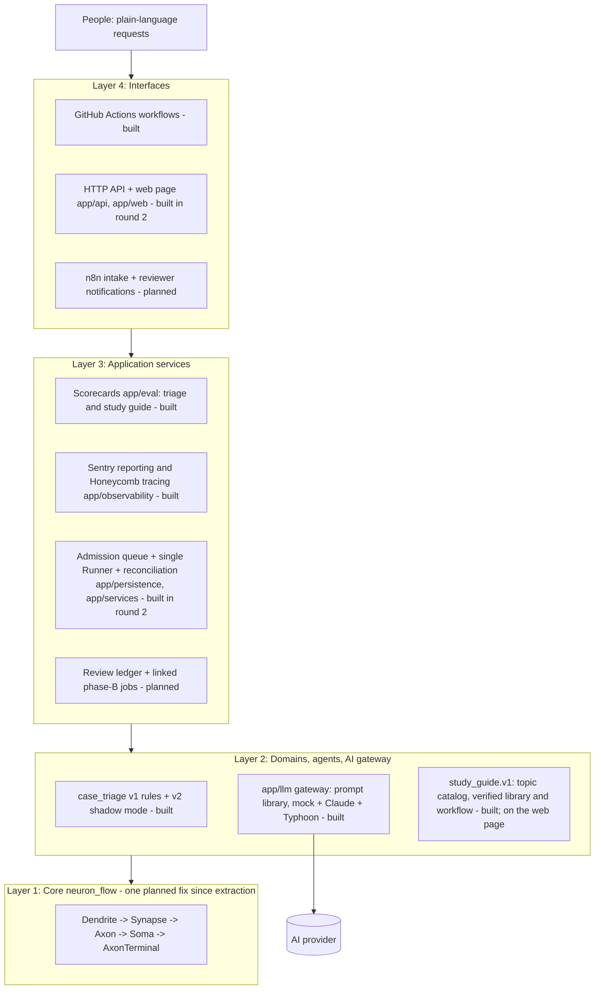

# System Neuron Flow AI — Architecture

**Current as of 2026-11-07** (`main` @ `cf06f4d`, after the study guide on the web page (PR #39); first
written for round 2, PR #11, on top of `59c6889`). This file replaces
"Architecture Review & Revised Architecture v2" (31 Oct 2026). That review's dated code observations were
re-checked against the current code and folded into §3. The AI design comes from the v3 roadmap, and its
round 1 is built (§4). Round 2 adds the intake API, the durable job queue, the single Runner with crash
reconciliation and a web page (§5, §6; details in [intake_queue.md](intake_queue.md)).

## 1. Design philosophy

Every decision below serves the owner's philosophy ([full text, mostly Thai](design_philosophy.md)):
- **Plain language outside, deep work inside.** Everyday and metaphorical language in; structured, checked,
  auditable work inside.
- **Understand, elaborate on request, stay inside the frame.** The frame is versioned data, and "out of scope"
  is a valid answer.
- **AI proposes, code verifies, people decide what matters.**
- **No perfectionism.** Small measured steps and honest uncertainty.
- **Equitable support without being asked.** When technology comes up, the first response offers study
  resources, what each one is for, and which topics to study first.

## 2. Four layers



| Layer | Responsibility | Built | Planned |
|---|---|---|---|
| 1 Core `neuron_flow/` | Spec validation, static DAG scheduling, bounded child processes, retries, recovery, events, verified receipts, integrity, case memory, candidate gate. No HTTP, business rules, credentials or user authorisation. | All of it; changed once since commit `09100f7`: the telemetry fix (roadmap 1.1, PR #21) | No further Core change planned |
| 2 Domains & agents `app/domains/`, `app/llm/` | Input contracts, trusted agent registry, fixed DAG templates, validators, AI calls | case_triage v1 and v2, AI gateway; `study_guide.v1`, a second unrelated domain: versioned topic catalog, verified resource library with a weekly link check, and the five-step workflow (roadmap 3.1, 3.2) | The study guide's scorecard (3.3) |
| 3 Application services | Admission, idempotency, the only Runtime owner, crash reconciliation, review decisions, results, measurement, monitoring | Scorecard (`app/eval/`), Sentry reporting (`app/observability/`), admission queue (`app/persistence/`), admission, Runner with reconciliation, results (`app/services/`) | Review ledger, artifact store (Milestone C) |
| 4 Interfaces | Authentication, request validation, status pages, human decisions | GitHub Actions workflows (tests, scorecard, Sentry check, container check, manual live runs with Claude or Typhoon); HTTP API and web page (`app/api/`, `app/web/`) behind one shared access key, started by `app/serve.py` in one container for Render (`render.yaml`; Railway also configured) | n8n intake and notifications, per-reviewer identity, review decisions |

**Dependency rule:** Interface → Services → Domain → Core. Core never imports `app.*`. A domain builds specs
and registers agents. It never re-implements retries or scheduling, and it never writes to Core SQLite.

## 3. Core constraints that shape every design

Each row was re-checked against the current code.

| Constraint in the code | Consequence for the design |
|---|---|
| `Runtime` holds `WorkspaceLock(workspace/runtime.lock)` | One controller per workspace. Only a single Runner may open it; an API must never hold the lock |
| `Soma.run(job_id)` runs a whole static DAG in a blocking loop | Durable admission and queueing belong to the application layer |
| Step states `PENDING, RUNNING, RETRY_WAIT, SUCCEEDED, FAILED, BLOCKED`; jobs may end `DELIVERY_FAILED`; no pause/resume | Human review is modelled as two linked jobs, not a paused one |
| JSON only, ≤ 1 MiB per message, ≤ 1000 steps, `max_attempts` 1–5 | Large files go to an artifact store and are passed by reference + hash |
| `AgentDefinition(name, entrypoint, validator, version)`; the version is frozen per job | Agents come from a trusted registry. The version carries AI provenance (§4) |
| Same `job_id` with a different spec is rejected | The application must map request idempotency keys to job ids |
| Interrupted `RUNNING` steps are retried and count against `max_attempts` | External side effects are not exactly-once; they need their own idempotency |
| `events_for` returns every event after a cursor, with no page size | A public API needs a bounded, paginated adapter |
| Receipts and manifests verify bytes with SHA-256 | Checksums do not prove who wrote something, so review identity needs authentication |
| Telemetry records each agent step under its own step id, next to Core's own phases `contract_validation` and `delivery` (fixed in PR #21; the legacy `csv_*` mapping is gone) | Step ids in the catalog must not reuse those two names; a test checks it |
| `CaseMemory` needs six profile dimensions and caller-declared review evidence; `candidate_gate` flags any changed outcome | These detect regressions; they are not accuracy proof and not automatic decision makers |

## 4. AI inside the architecture (built in round 1, PR #9)

- **The AI is a trusted Layer 2 agent, never the orchestrator.** Core still schedules, retries and records.
- **One gateway, `app/llm/`:**
  - The prompt and its answer schema live in one versioned file, and one SHA-256 covers both.
  - Three providers: `mock` (offline keyword simulation), `anthropic` (Claude, paid key) and `typhoon`
    (Typhoon by SCB 10X, free within rate limits, ADR-021). Claude has its own module; Typhoon goes through
    `providers/openai_compat.py`, which serves any OpenAI chat-completions service from one table in
    `config.py`. Each reads its own key variable (`ANTHROPIC_API_KEY`, `TYPHOON_API_KEY`).
  - Answers use structured JSON output (`output_config.format` for Claude, `response_format` `json_schema`
    strict for OpenAI-format services), built from the prompt's own answer schema. Typhoon ignores
    `response_format`, so for it the client also states the answer format in words, built from the same
    schema, and the format version is part of the agent version (ADR-022). Neither client sends sampling
    parameters, tools or forced `tool_choice` (current Claude 5.5 models reject them).
  - The clients refuse HTTP redirects (`providers/_http.py`), so the key cannot travel to another host.
  - The API key is read from the environment at call time. It never appears in a job, an output or a log.
  - Personal data is masked before every call (`app/llm/redaction.py`, roadmap 7.1): the gateway accepts
    only text from `mask()`, the AI sees placeholders such as `[PHONE]`, and the AI step records how many
    items of each kind it masked. The masking version is part of the agent version.
- **The error class decides what Core does:**

  | Error | Examples | What happens |
  |---|---|---|
  | Transient | 408, 429, 5xx, timeouts, network | Retry |
  | Setup | 401, 403, 404 | Fail loudly |
  | Rejected request | other 4xx, redirects | Fail loudly |
  | Off-contract answer | broken JSON, unknown value, cut off | Retry, then "unavailable" |
  | Refusal | `stop_reason: refusal`; on OpenAI-format services also `finish_reason: content_filter`, a `refusal` message, or HTTP 400 `content_filter` (a filter blocked one case's text) | "unavailable" at once |

- **Validators check three things before Core saves any output:**
  - Schema: the fields and types are right.
  - Invariants: the queue matches the category, and the provenance matches the frozen job settings.
  - Policy: there is never an automatic decision.
- **Provenance:** the agent version is
  `llm=<provider>/<model>;prompt=<id>@sha256:<hash>;max_tokens=…;effort=…;redaction=<version>`. Changing the
  model, the prompt or the masking rules therefore creates a new version, and an old job refuses to run on it.
- **Shadow mode:** the rules stay official. The AI adds a second opinion, and a disagreement raises review to
  elevated. Every proposal stays `PENDING_HUMAN_REVIEW`.
- **Prompts completed from versioned data (ADR-019):** the study guide completes its prompt files before
  each call. Detection gets one line per catalog topic, and its answer is limited to the catalog's ids plus
  `out_of_scope`; the explanation gets one note field per step that code chose. The file keeps its own
  hash, and the agent version adds the library tag (`…;library=v1@sha256:…`), so a changed catalog is a new
  version too.
- **Informational answers (ADR-018):** a study guide decides nothing about anyone and sends nothing outside,
  so it ends `COMPLETED` without review. The AI may only pick a catalog topic and write short notes; code
  picks and orders the resources and inserts every URL from the verified library, and AI text containing a
  link is refused.
- **Monitoring:** failed steps send Sentry errors; degraded steps (`{"status": "unavailable"}`) send grouped
  warnings. With tracing on, every AI call is also a span with its model, tokens and latency (GenAI
  semantic conventions; [observability_tracing.md](observability_tracing.md)).
- **Agent patterns for later:**
  - A: a bounded tool loop inside one step (preferred first).
  - B: a planner step that produces a plan, validated and run as a new linked job.
  - C: a dynamic DAG inside Core is **not** recommended.

## 5. Job lifecycle (steps 1–3 and 5 built in round 2; step 4 is Milestone C)

1. **Built.** `POST /v1/jobs` checks the access key and the input, assigns a `job_id`, and stores
   `idempotency_key` + request fingerprint in the application queue (`<data>/app/queue.sqlite3`). It replies
   `202 QUEUED` only after the commit.
2. **Built.** The single Runner claims the oldest job, freezes the exact Core spec in the queue *before*
   submitting it, then calls `submit` and `run` on its `Runtime(<data>/core, agents=…)`. It writes a
   path-free summary of the Core outcome back into the job record.
3. **Built.** A proposal that needs approval marks the job `REVIEW_REQUIRED`. The Core job itself has
   already finished.
4. *Milestone C.* An authenticated reviewer sends a versioned decision. **Approve** creates one linked
   phase-B job; **reject** ends at `REJECTED`.
5. **Built.** After a Runner restart, every job still `RUNNING` in the queue is reconciled with Core state,
   always with its frozen spec. A job whose spec would now be built differently (model, prompt or code
   changed) fails as `configuration_changed`; a job claimed `max_claims` times fails as
   `runner_attempts_exhausted`. A different spec is never submitted under an existing `job_id`.

Application states: `QUEUED → RUNNING → COMPLETED | REVIEW_REQUIRED | FAILED | DELIVERY_FAILED` (case triage
always ends `REVIEW_REQUIRED`; the informational `study_guide.v1` ends `COMPLETED`, ADR-018) and
`QUEUED → CANCELLED` (built; cancel only before the claim, roadmap 1.3), then
`REVIEW_REQUIRED → APPROVED → (linked phase-B QUEUED)` or `REJECTED` (Milestone C).

## 6. API contract

Built in round 2 (full reference in [intake_queue.md](intake_queue.md)):
- `POST /v1/jobs` with `{"workflow_type": "case_triage.v2", "idempotency_key": "…", "input": {"case_id": "…", "summary": "…"}}`
  replies `202 {"job_id": "…", "status": "QUEUED", …}`; the same key and request again replies `200` with the
  same job; the same key with another request replies `409`.
- `GET /v1/jobs/{job_id}` returns status, the step plan frozen at claim, the review summary, a step
  timeline, AI provenance and the receipt hash. It never returns internal paths, params or credentials.
- `GET /v1/jobs/{job_id}/events?after=<cursor>&limit=1-100` returns bounded pages.
- `POST /v1/jobs/{job_id}/cancel` withdraws a job that is still `QUEUED` (`409 not_cancellable` otherwise;
  repeating it on a cancelled job returns `200` with the same record).
- `GET /v1/jobs?limit=&before=` lists jobs newest first; `GET /v1/status` shows the Runner heartbeat, queue
  counts, queue and run-time figures (waiting count and oldest age; median and slowest wait and run times
  per workflow over the newest 100 finished jobs; failures by reason; roadmap 5.3), AI mode, storage, the
  input limits (a case's summary and a study question's message; roadmap 3.4) and each workflow's steps (ids,
  agents, order, retry budget, time limit; never params); `GET /healthz` is the unauthenticated liveness
  check.
- Every response carries `X-Request-Id` (the client's id when it is safe to log, otherwise a new one). The
  same id ends the access log line and is stored in a new job's `job.queued` event (roadmap 1.2).

Planned (Milestone C):
- `POST /v1/reviews/{review_id}/decisions` takes `APPROVE`/`REJECT`, the reviewer from the authenticated
  session, a reason and the expected version.
- `GET /v1/artifacts/{artifact_id}` is authorised access by id, never by a user-supplied path.

Workflow types in the catalog (`app/services/workflows.py`): `case_triage.v2` (the page's default) and
`case_triage.v1` with `{"case_id", "summary"}`, and `study_guide.v1` with `{"message"}` (4–500 characters;
[study_guide.md](study_guide.md)).

Requests never carry agent import paths, code, tenant ids or callbacks.

## 7. Code organisation

```text
neuron_flow/                   Core runtime (one change since extraction: the telemetry fix)
app/domains/case_triage/       v1 rules (agents.py, workflow.py), contracts.py, v2 shadow_agents.py, shadow_workflow.py
app/domains/study_guide/       library.py (topic catalog + resource library: checks, SHA-256), link_check.py, catalog/*_v1.json;
                               workflow.py, agents.py, planning.py, ai_prompts.py, mock_answers.py (study_guide.v1)
app/llm/                       config, errors, gateway, prompts, redaction (personal-data masking), prompt_library/, providers/{mock, anthropic, openai_compat, _http}
app/eval/                      triage_shadow_eval.py, study_guide_eval.py, common.py (the eval gate's shared parts);
                               golden/case_triage_synthetic_v1.json (61 cases), golden/study_guide_synthetic_v1.json (67 requests)
app/observability/             sentry.py (step failures, degraded AI, Runner recoveries); tracing.py (OTLP/JSON exporter) and job_spans.py (a job's spans)
app/persistence/               queue_store.py: the application job queue, events and Runner heartbeat (SQLite)
app/services/                  workflows.py (catalog), admission.py, runner.py (with reconciliation), results.py, metrics.py
app/api/                       routes.py (ApiApp), server.py (standard-library HTTP server), limits.py
app/web/                       index.html, app.css, app.js: the Thai web page (chat layout with a case / study-question switch, the study guide's layered answer, Flow and Trace, read-only settings)
app/boot.py                    process 1 of the image: takes the data folder, drops root, becomes tini
app/settings.py, app/serve.py  environment settings; the launcher (API + supervised Runner in one container)
Dockerfile, render.yaml        the container and the Render Blueprint (railway.json kept for Railway)
examples/                      case_triage_demo, case_triage_shadow_demo, study_guide_demo, sentry_smoke_test, service_smoke_test
tests/                         284 tests: core, triage v1/v2, AI gateway, Typhoon provider, masking, scorecards, eval gates, Sentry, tracing, API, queue, Runner, HTTP, metrics, study library, link check, study guide, web page, robustness benchmark
tests/robustness/              the robustness benchmark, stage 1 (docs/benchmarking.md): synthetic_v1.json (270 edge cases), open_extract_v1.json
                               (BLNS, JSONTestSuite, CLINC150, BANKING77, pinned; NOTICE.md), bench.py, build_open_extract.py, triage_edge_golden_v1.json
tests/baselines/               shadow_eval_mock.json, study_guide_eval_mock.json: every case's answer with the mock AI (the eval gates' baselines);
                               robustness_v1.json: every robustness item's outcome, failures included
.github/workflows/             core-tests (with the robustness gate), service-container, tracing-check, secret-scan, sentry-smoke, study-links (weekly); manual: shadow-eval and study-guide-eval with Typhoon or Claude
.github/gitleaks.toml          secret scan rules (gitleaks defaults + Sentry DSN + Honeycomb keys); .github/.gitleaksignore: reviewed findings
.github/scripts/               check_render_blueprint.py: render.yaml structure, build filter, Render's schema; check_traces.py
.github/otel/                  collector.yaml: the OpenTelemetry Collector that the tracing check sends to
planned: review ledger and artifact store
```

## 8. Architecture decisions (ADRs)

| ADR | Decision | Status |
|---|---|---|
| 001 | One controller per workspace; only the Runner opens Runtime | In force; the API never opens it, and a second Runner fails with `WorkspaceBusy` |
| 002 | Durable admission before execution; reply 202 only after commit | In force |
| 003 | Single machine first; no Redis, Postgres or distributed claims | In force: SQLite queue on one disk |
| 004 | Two-phase human review as linked jobs | Accepted; Milestone C |
| 005 | Trusted agents only; versions frozen per job | In force |
| 006 | Large artifacts stay outside Core messages | Accepted; not needed yet |
| 007 | Side effects are not automatically exactly-once | In force; no side-effect agents exist yet |
| 008 | Honest audit claims; hashes prove bytes, not authorship | In force |
| 009 | CaseMemory and candidate_gate are optional regression tools | In force; the scorecard uses candidate_gate |
| 010 | In shadow mode the AI is advisory; rules stay official until measurements justify more | In force |
| 011 | The prompt and answer schema are one versioned file; its hash is part of agent identity | In force |
| 012 | Provider hiccups degrade gracefully; setup errors fail loudly | In force |
| 013 | Secrets come only from the environment at call time | In force; tested by scanning every stored file |
| 014 | API and Runner run in one container on one disk; the launcher supervises the Runner. A disk attaches to a single instance, so two Runners never share it. Host: Render (Railway paused new sign-ups on 22 Oct 2026) | In force (round 2) |
| 015 | Interrupted jobs resume only under the spec frozen at their first claim; any drift fails them as `configuration_changed` | In force (round 2) |
| 016 | Until reviewer identity exists (Milestone C), the API is protected by one shared access key, with per-client limits on wrong keys | In force (round 2); to be replaced |
| 017 | Tracing uses a small standard-library OTLP/HTTP JSON exporter, not the OpenTelemetry SDK. Job, step and AI spans are built after the job from durable records (queue record, Core step events, the AI view); only allow-listed ASCII attributes can be sent | In force (PR #30). Trade-off: no automatic instrumentation, no metrics or logs signals, and two modules (about 700 lines with comments) to maintain. Attribute names follow the semantic conventions, so the SDK can replace it without changing the data |
| 018 | An informational workflow (today `study_guide.v1`) ends `COMPLETED` without human review. It may only answer with information from versioned data; it records no decision, changes nothing and sends nothing outside, and its validator refuses a `decision` field. Anything that decides about a person or acts outside still goes to review (rule 4) | In force (roadmap 3.2, PR #33). Trade-off: nobody checks an answer before the person reads it, so the answer must stay safe by construction (catalog topics only, at most 5 library links, code-inserted URLs, "out of scope" instead of guessing) and is measured in 3.3 |
| 019 | A prompt file may be completed from versioned data before a call (`app.llm.prompts.specialize`): extra system lines, fixed choices for a text field, extra text fields. The file keeps its hash, and the agent version carries the data's own version next to it | In force (PR #33, the study guide's catalog). Trade-off: the exact prompt text is no longer one file to read, but it is a pure function of two versioned inputs and is rebuilt the same way for every attempt |
| 020 | A second real provider, GitHub Models (`github`), so the first live measurement does not wait for a paid Claude key: the owner's Anthropic account asks for card verification (2026-11-06). Same gateway, validators, masking and error classes as Claude; its own key variable (`GITHUB_MODELS_TOKEN`); the manual scorecard workflows pass the workflow's own `GITHUB_TOKEN` with only `contents: read` and `models: read`, so there is no key to create or store. A content-safety block of one case's text (HTTP 400 `content_filter`) counts as a refusal, not a setup error | **Superseded by ADR-021.** Built in PR #35 and #36; GitHub had retired GitHub Models on 2026-07-30 (found when the first run got a bare `OK` back), so the provider and its workflows were removed. Trade-offs: the free tier is rate-limited (about 15 requests a minute and 150 a day per low-tier model), so the scorecards pace cases (`--min-interval-s`); results belong to the chosen model, not to Claude, and say so on the run page; GitHub's data terms for the catalog were not reviewed here, so only synthetic data may go to it (rule 9; D4 decides real data) |
| 021 | Typhoon (`typhoon`) replaces GitHub Models as the free real provider. SCB 10X hosts it as a free research API (no card; about 200 requests a minute, 5 a second) in the OpenAI chat-completions format, so it reuses the ADR-020 client, now `providers/openai_compat.py` with a provider table. Thai-first, which suits a case set that is half Thai. Key from `TYPHOON_API_KEY` (a repository secret; the owner created it on 2026-11-06). Every live run first checks the connection with one fixed synthetic sentence and shows the raw reply (`.github/scripts/llm_probe.py`) | In force (PR #37). Trade-offs: the API is a beta research showcase without formal support, and it collects usage data to improve its models, so it may only ever see synthetic data (rule 9; D4). The first run (2026-11-06) showed that it ignores strict `json_schema` output (ADR-022). Results describe Typhoon, never Claude |
| 022 | An OpenAI-format client may also state the answer format in words. When a provider is listed in `ANSWER_FORMATS` (`app/llm/config.py`; today only `typhoon`, format `json-instruction-v1`), the client appends to the system prompt an instruction built from the prompt's own answer schema (the keys in order, each choice field's allowed values, one JSON object and nothing else), and reads the reply from its first `{` to its last `}` after removing a Markdown code fence. The same validators then check the object; plain `key: value` lines, extra keys, a wrong choice or two objects are still refused, never parsed. The format version is part of the agent version (`;format=json-instruction-v1`), so a job frozen before the change fails as `configuration_changed` (ADR-015). Claude's requests and versions are unchanged | In force (PR #38). Found on the first live run (2026-11-06): Typhoon answered HTTP 200 but ignored `response_format`, so all 5 answers were plain lines and were refused ([evidence](evidence/2026-11-06-first-live-typhoon.md)). Trade-off: the model sees text that is not in the prompt file, so the prompt's hash alone no longer names everything sent; the format version in the agent version closes that gap, and the instruction is a pure function of the answer schema |
| 023 | On the web page, an informational request (today a study question, roadmap 3.4) is sent as soon as the person presses Enter, without the confirm card that a case shows first. Its answer asks back "เข้าใจถูกไหม" with what the system understood, and a "แก้คำถาม" button puts the question back in the box. A case still shows its steps and waits for "ยืนยันและส่ง". Until the plain-language router (roadmap 4.2) chooses by itself, a switch above the box ("เคสลูกค้า" / "อยากเรียน") says which kind the next message is | In force (PR #39). Trade-off: a mistyped question reaches the AI without a second look (personal data masked first, 7.1). It decides nothing and sends nothing outside (ADR-018), costs one or two AI calls, and its answer shows what was understood, so a wrong reading is visible and easy to correct. Anything that decides about a person or acts outside keeps the confirm step and human review (rule 4) |
| 024 | Open datasets in tests and benchmarks count as synthetic data (rule 9) only when they are: written for the dataset (hand-made test strings, crowd-written or expert-written requests), openly licensed for redistribution, free of real people's records, and pinned to an upstream commit with every file's SHA-256, attribution and the changes made (`tests/robustness/NOTICE.md`). Labels mapped into this project's categories are marked as the developer's mapping. Real-world text (social-media posts, call-centre transcripts, real tickets) still needs D4 | In force (roadmap 5.4, PR #41). Used: BLNS and JSONTestSuite (MIT), CLINC150 (CC BY 3.0), BANKING77 (CC BY 4.0); planned: MASSIVE (CC BY 4.0), deepset/prompt-injections (Apache-2.0). Left out: ai4privacy (non-commercial, no redistribution or derivatives without a written licence), truevoice-intent and social-media corpora (real people's words). Trade-off: crowd-written text is cleaner and more uniform than real cases, so these sets find robustness bugs and rule gaps, not real-world accuracy |

## 9. Acceptance gates

**Met in round 1 (all automated):**
- AI shadow mode was added with **zero Core changes**.
- A second, unrelated domain (`study_guide.v1`, roadmap 3.2) runs on the same Core with **zero Core changes**
  (PR #33: no file under `neuron_flow/` changed). Its gates are automated: answers use only library links and
  at most 5 resources; out-of-scope answers list what the guide covers; an AI text with a link is refused;
  a job frozen with another library is never answered.
- Changing the model or prompt stops an old job from re-running.
- Prompt injection (EN/TH) cannot pick a queue or make a decision.
- An AI outage still lets the case reach review.
- The API key is absent from every stored file.
- Redirects cannot carry the key elsewhere.
- Personal data that the masking rules recognise never reaches the provider (roadmap 7.1; tested with Thai
  and English samples against the fake Claude API).
- Tests pass on Python 3.10–3.13.

**P0 for the first API release, met in round 2 (automated; tests listed in [intake_queue.md](intake_queue.md)):**
- Concurrent identical requests produce one job, and a mismatched payload produces a conflict.
- Admission stays responsive while jobs run, and only one Runner holds the lock.
- Killing the Runner mid-step reconciles correctly within the retry budget.
- Invalid input is rejected before any agent runs.
- A failed validator blocks only the dependent steps.
- Delivery conflicts get their own status.
- The container runs without root, keeps its data across a restart and stops cleanly (CI container job).
  That job now runs without `CAP_KILL`, as Render does. Until `app/boot.py` (2026-11-01), process 1
  (tini) ran as root and could not pass SIGTERM on there, so stops on Render were not clean. On Render,
  stops have been graceful since then ([evidence](evidence/2026-11-03-render-operations.md)).

**P0 still open:**
- A review decision applies once per version, unauthorised reviews are denied, and approval creates exactly
  one phase-B job (Milestone C).
- Side-effect agents need an idempotency contract (none exist yet).
- Hash checks catch changed artifacts (no artifact store yet).

**P1:**
- Done: the telemetry phase fix (§3, PR #21); event pagination for the API (`limit` 1–100 with a cursor);
  correlation (request) ids in logs (PR #22); explicit cancellation of queued jobs (PR #23); queue and
  run-time figures on the status page (PR #26, ROADMAP 5.3); the eval gate in CI, which fails when any
  per-case answer of the mock scorecard changes (PR #27, ROADMAP 5.2); a secret scan of every commit of
  every branch in CI, with the Sentry DSN read only from a repository secret (PR #29, ROADMAP 7.4);
  tracing to Honeycomb, one trace per job with its steps and AI call, with the encoding checked against the
  OpenTelemetry Collector in CI (PR #30, ROADMAP 5.1) and seen in Honeycomb on Render on 2026-11-03
  (`docs/evidence/2026-11-03-first-trace-honeycomb.md`); the study guide's scorecard and eval gate in CI, which
  fails when a link outside the library or more than 5 resources appears in any answer, or when any
  request's answer changes (PR #34, ROADMAP 3.3; mock in CI, Typhoon runs by hand); the page's contracts in CI: every example on
  it passes its workflow's input contract, it names every step of every workflow and every code of a study
  answer, it never inserts server data as HTML, and it links only to https addresses, opened without a
  referrer (PR #39, ROADMAP 3.4, `tests/test_web_page.py`); the robustness gate, stage 1 (ROADMAP 5.4): 270
  synthetic edge cases and four pinned open datasets through intake, rules, masking, AI replies, Core contracts
  and whole jobs, on every push. It fails when any item's outcome changes from `tests/baselines/robustness_v1.json`,
  whose first run records 8 bugs to fix in 5.5 (PR #41, [evidence](evidence/2026-11-07-robustness-stage1.md)).
- Open: retention and backup/restore drills (1.4, needs a disk), API authentication hardening (2.1, 7.2).

**P2 (do not build early):** multi-tenancy, distributed workers, Postgres, object storage, SLAs, a hosted
dashboard.

## 10. Milestones

| Milestone | Content | Status |
|---|---|---|
| A | case_triage v1 rules, synthetic demo, tests | Done |
| A2 | AI gateway, v2 shadow mode, scorecard, Sentry reporting | Done (PR #8, #9); a free Typhoon provider added (ADR-021, after GitHub Models was found retired). First live runs with Typhoon on 2026-11-06 after the answer-format fix (ADR-022): AI correct 60/61 on the synthetic triage set in two runs ([evidence](evidence/2026-11-06-first-live-typhoon.md)); Claude not run yet (D2) |
| P1-fix | Neutral telemetry phase names | Done (PR #21, roadmap 1.1) |
| B | Admission queue, single Runner, reconciliation, thin API, web page | Done (PR #11); live on Render's free plan since 2026-11-01; page redesigned as a chat layout with Flow, Trace and read-only settings (PR #18, roadmap 1.6) |
| C | Two-phase review, decision ledger, n8n notifications | Open |
| D | OpenTelemetry tracing, eval gates in CI | Done: the per-case eval gates (5.2 for triage; 3.3 for the study guide), queue/run-time figures (5.3), Sentry, request ids, and tracing (5.1, PR #30), with the first trace seen in Honeycomb on 2026-11-03. Added on 2026-11-07: the robustness benchmark, stage 1 of the plan in [benchmarking.md](benchmarking.md) (5.4, PR #41; its 8 bugs are 5.5); stages 2–3 (5.6, 5.7) planned |
| E | Planner pattern (B), MCP server, second domain with zero Core changes | Open |
| — | `study_guide.v1`: first-response study guide ([design_philosophy.md](design_philosophy.md), [study_guide.md](study_guide.md)) | Workflow and scorecard built: the topic catalog, the verified resource library, the weekly link check (3.1, PR #32), the five-step workflow in the catalog (3.2, PR #33) and the 67-request scorecard with its eval gate (3.3, PR #34), with the mock AI in CI; first live run with Typhoon on 2026-11-06: topic correct 46/48, 0 of 142 links outside the library ([evidence](evidence/2026-11-06-first-live-typhoon.md)); on the web page with a layered answer (3.4, PR #39; questions sent without a confirm card, ADR-023), waiting for the owner's test on the live page; Claude after D2 |

The order of the remaining work, with tasks, acceptance checks and owner decisions for each step, is in
[ROADMAP.md](ROADMAP.md).

## 11. Limits

- This is a single-machine runtime. Its child processes isolate failures; they are **not** a sandbox for
  untrusted code.
- The HTTP server is Python's standard-library server with request, connection and time limits. It suits a
  single-owner pilot, not public traffic. One shared access key is not per-person authentication.
- All data is synthetic, and mock-AI scores test the pipeline, not accuracy. Masking before AI calls is
  pattern-based and misses names without a title, addresses and more, so it does not make real data safe.
- Every process in the container (API, Runner, Core workers) runs as one user with one environment, so each
  of them could read the AI key once it is set. Options and a recommendation are in ROADMAP 7.1.
- The Sentry DSN that the smoke workflow carried until 2026-11-03 is still in the git history. It can only
  submit events; it must be revoked in Sentry before the repository is made public (ROADMAP 7.4).
- The only live-model results are Typhoon's first runs on the synthetic sets (2026-11-06, one or two runs
  per scorecard, [evidence](evidence/2026-11-06-first-live-typhoon.md)). The cases and labels are the developer's,
  so they are a first measurement, not accuracy, and they describe that model only. Claude has not been run
  (D2).
- Security review, benchmarks and user studies do not exist yet. No document should claim them.
