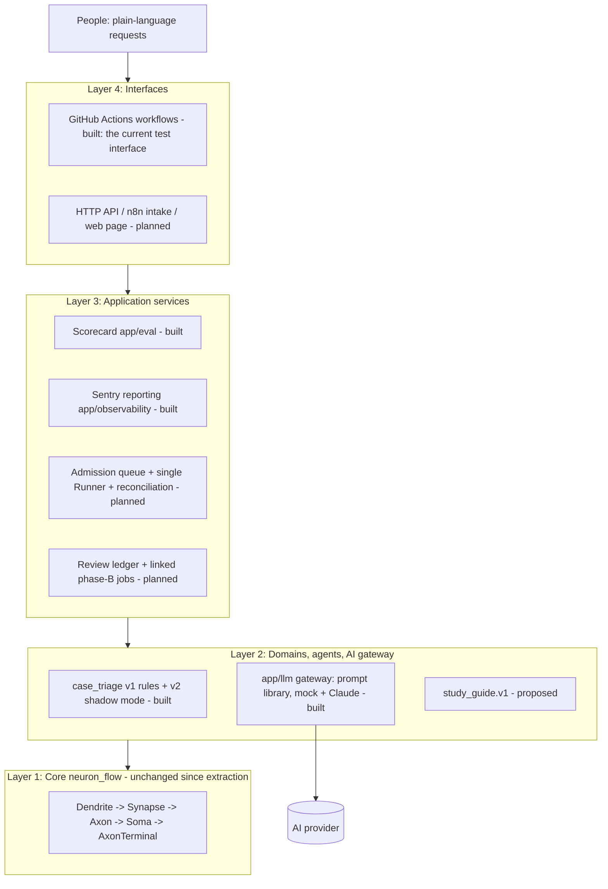

# System Neuron Flow AI — Architecture

**Current as of 2026-11-01** (`main` @ `59c6889`). This file replaces "Architecture Review & Revised
Architecture v2" (31 Oct 2026). That review's dated code observations were re-checked against the current
code and folded into §3. The AI design comes from the v3 roadmap, and its round 1 is now built (§4).

## 1. Design philosophy

Every decision below serves the owner's philosophy ([full text, mostly Thai](design_philosophy.md)):
- **Plain language outside, deep work inside.** Everyday and metaphorical language in; structured, checked,
  auditable work inside.
- **Understand, elaborate on request, stay inside the frame.** The frame is versioned data, and "out of scope"
  is a valid answer.
- **AI proposes, code verifies, people decide what matters.**
- **No perfectionism.** Small measured steps and honest uncertainty.
- **Equitable support without being asked.** When technology comes up, the first response offers study
  resources, what each one is for, and which topics to study first.

## 2. Four layers



| Layer | Responsibility | Built | Planned |
|---|---|---|---|
| 1 Core `neuron_flow/` | Spec validation, static DAG scheduling, bounded child processes, retries, recovery, events, verified receipts, integrity, case memory, candidate gate. No HTTP, business rules, credentials or user authorisation. | All of it, unchanged since commit `09100f7` | P1 telemetry fix only (§3) |
| 2 Domains & agents `app/domains/`, `app/llm/` | Input contracts, trusted agent registry, fixed DAG templates, validators, AI calls | case_triage v1 and v2, AI gateway | `study_guide.v1`, a second unrelated domain |
| 3 Application services | Admission, idempotency, the only Runtime owner, crash reconciliation, review decisions, results, measurement, monitoring | Scorecard (`app/eval/`), Sentry reporting (`app/observability/`) | Queue, Runner, reconciliation, review ledger, artifact store (Milestones B–C) |
| 4 Interfaces | Authentication, request validation, status pages, human decisions | GitHub Actions workflows (tests, scorecard, Sentry check, manual Claude run) | HTTP API, n8n intake and notifications, a simple web page |

**Dependency rule:** Interface → Services → Domain → Core. Core never imports `app.*`. A domain builds specs
and registers agents. It never re-implements retries or scheduling, and it never writes to Core SQLite.

## 3. Core constraints that shape every design

Each row was re-checked against the current code.

| Constraint in the code | Consequence for the design |
|---|---|
| `Runtime` holds `WorkspaceLock(workspace/runtime.lock)` | One controller per workspace. Only a single Runner may open it; an API must never hold the lock |
| `Soma.run(job_id)` runs a whole static DAG in a blocking loop | Durable admission and queueing belong to the application layer |
| Step states `PENDING, RUNNING, RETRY_WAIT, SUCCEEDED, FAILED, BLOCKED`; jobs may end `DELIVERY_FAILED`; no pause/resume | Human review is modelled as two linked jobs, not a paused one |
| JSON only, ≤ 1 MiB per message, ≤ 1000 steps, `max_attempts` 1–5 | Large files go to an artifact store and are passed by reference + hash |
| `AgentDefinition(name, entrypoint, validator, version)`; the version is frozen per job | Agents come from a trusted registry. The version carries AI provenance (§4) |
| Same `job_id` with a different spec is rejected | The application must map request idempotency keys to job ids |
| Interrupted `RUNNING` steps are retried and count against `max_attempts` | External side effects are not exactly-once; they need their own idempotency |
| `events_for` returns every event after a cursor, with no page size | A public API needs a bounded, paginated adapter |
| Receipts and manifests verify bytes with SHA-256 | Checksums do not prove who wrote something, so review identity needs authentication |
| Telemetry still maps legacy agent names `csv_validate/csv_calculate/csv_verify` (`engine.py`) | **P1 fix:** use neutral or agent-declared phase names |
| `CaseMemory` needs six profile dimensions and caller-declared review evidence; `candidate_gate` flags any changed outcome | These detect regressions; they are not accuracy proof and not automatic decision makers |

## 4. AI inside the architecture (built in round 1, PR #9)

- **The AI is a trusted Layer 2 agent, never the orchestrator.** Core still schedules, retries and records.
- **One gateway, `app/llm/`:**
  - The prompt and its answer schema live in one versioned file, and one SHA-256 covers both.
  - Answers use structured JSON output. Current Claude 5.5 models reject forced `tool_choice` and sampling
    parameters, so the client sends neither.
  - The client refuses HTTP redirects, so the key cannot travel to another host.
  - The API key is read from the environment at call time. It never appears in a job, an output or a log.
- **The error class decides what Core does:**

  | Error | Examples | What happens |
  |---|---|---|
  | Transient | 408, 429, 5xx, timeouts, network | Retry |
  | Setup | 401, 403, 404 | Fail loudly |
  | Rejected request | other 4xx, redirects | Fail loudly |
  | Off-contract answer | broken JSON, unknown value, cut off | Retry, then "unavailable" |
  | Refusal | `stop_reason: refusal` | "unavailable" at once |

- **Validators check three things before Core saves any output:**
  - Schema: the fields and types are right.
  - Invariants: the queue matches the category, and the provenance matches the frozen job settings.
  - Policy: there is never an automatic decision.
- **Provenance:** the agent version is
  `llm=<provider>/<model>;prompt=<id>@sha256:<hash>;max_tokens=…;effort=…`. Changing the model or the prompt
  therefore creates a new version, and an old job refuses to run on it.
- **Shadow mode:** the rules stay official. The AI adds a second opinion, and a disagreement raises review to
  elevated. Every proposal stays `PENDING_HUMAN_REVIEW`.
- **Monitoring:** failed steps send Sentry errors; degraded steps (`{"status": "unavailable"}`) send grouped
  warnings.
- **Agent patterns for later:**
  - A: a bounded tool loop inside one step (preferred first).
  - B: a planner step that produces a plan, validated and run as a new linked job.
  - C: a dynamic DAG inside Core is **not** recommended.

## 5. Target job lifecycle (Milestones B–C; not built)

1. `POST /v1/jobs` validates the caller and the input, assigns a `job_id`, and stores `idempotency_key` +
   request fingerprint in the application queue. It replies `202 QUEUED`.
2. The single Runner claims the work, opens `Runtime(workspace, agents=…)`, then calls `submit` and `run`.
   It writes the Core outcome back into the application's job record.
3. If the result needs approval, the application marks it `REVIEW_REQUIRED`. The Core job itself has already
   finished.
4. An authenticated reviewer sends a versioned decision. **Approve** creates one linked phase-B job;
   **reject** ends at `REJECTED`.
5. After a Runner restart, every claimed job is reconciled with Core state. A different spec is never
   re-submitted under an existing `job_id`.

Application states: `QUEUED → RUNNING → COMPLETED | REVIEW_REQUIRED | FAILED | DELIVERY_FAILED`, then
`REVIEW_REQUIRED → APPROVED → (linked phase-B QUEUED)` or `REJECTED`.

## 6. API contract (design, not implemented)

- `POST /v1/jobs` with `{"workflow_type": "case_triage.v2", "idempotency_key": "…", "input": {"case_id": "…", "summary": "…"}}`
  replies `202 {"job_id": "…", "status": "QUEUED"}`.
- `GET /v1/jobs/{job_id}` returns status, the review summary and a result digest. It never returns internal
  paths or credentials.
- `GET /v1/jobs/{job_id}/events?after=<cursor>&limit=100` returns bounded pages.
- `POST /v1/reviews/{review_id}/decisions` takes `APPROVE`/`REJECT`, the reviewer from the authenticated
  session, a reason and the expected version.
- `GET /v1/artifacts/{artifact_id}` is authorised access by id, never by a user-supplied path.

Requests never carry agent import paths, code, tenant ids or callbacks.

## 7. Code organisation

```text
neuron_flow/                   Core runtime (unchanged)
app/domains/case_triage/       v1 rules (agents.py, workflow.py), contracts.py, v2 shadow_agents.py, shadow_workflow.py
app/llm/                       config, errors, gateway, prompts, prompt_library/, providers/{mock, anthropic}
app/eval/                      triage_shadow_eval.py, golden/case_triage_synthetic_v1.json (61 cases)
app/observability/             sentry.py
examples/                      case_triage_demo, case_triage_shadow_demo, sentry_smoke_test
tests/                         53 tests: core, triage v1/v2, AI gateway, scorecard, Sentry
.github/workflows/             core-tests, sentry-smoke, shadow-eval-claude (manual)
planned: app/api/, app/services/ (admission, runner, reconciliation, review, results),
         app/persistence/ (queue, review, artifact stores), app/domains/study_guide/
```

## 8. Architecture decisions (ADRs)

| ADR | Decision | Status |
|---|---|---|
| 001 | One controller per workspace; only the Runner opens Runtime | Accepted; applies when the Runner is built |
| 002 | Durable admission before execution; reply 202 only after commit | Accepted; Milestone B |
| 003 | Single machine first; no Redis, Postgres or distributed claims | In force |
| 004 | Two-phase human review as linked jobs | Accepted; Milestone C |
| 005 | Trusted agents only; versions frozen per job | In force |
| 006 | Large artifacts stay outside Core messages | Accepted; not needed yet |
| 007 | Side effects are not automatically exactly-once | In force; no side-effect agents exist yet |
| 008 | Honest audit claims; hashes prove bytes, not authorship | In force |
| 009 | CaseMemory and candidate_gate are optional regression tools | In force; the scorecard uses candidate_gate |
| 010 | In shadow mode the AI is advisory; rules stay official until measurements justify more | In force |
| 011 | The prompt and answer schema are one versioned file; its hash is part of agent identity | In force |
| 012 | Provider hiccups degrade gracefully; setup errors fail loudly | In force |
| 013 | Secrets come only from the environment at call time | In force; tested by scanning every stored file |

## 9. Acceptance gates

**Met in round 1 (all automated):**
- AI shadow mode was added with **zero Core changes**.
- Changing the model or prompt stops an old job from re-running.
- Prompt injection (EN/TH) cannot pick a queue or make a decision.
- An AI outage still lets the case reach review.
- The API key is absent from every stored file.
- Redirects cannot carry the key elsewhere.
- Tests pass on Python 3.10–3.13.

**P0, before the first API release (not yet met):**
- Concurrent identical requests produce one job, and a mismatched payload produces a conflict.
- Admission stays responsive while jobs run, and only one Runner holds the lock.
- Killing the Runner mid-step reconciles correctly within the retry budget.
- Invalid input is rejected before any agent runs.
- A failed validator blocks only the dependent steps.
- A review decision applies once per version, unauthorised reviews are denied, and approval creates exactly
  one phase-B job.
- Delivery conflicts get their own status.
- Side-effect agents need an idempotency contract.
- Hash checks catch changed artifacts.

**P1:**
- The telemetry phase fix (§3).
- Event pagination.
- Phase metrics, retention and backup/restore drills.
- Correlation IDs in logs.
- API authentication hardening.
- Explicit cancellation.

**P2 (do not build early):** multi-tenancy, distributed workers, Postgres, object storage, SLAs, a hosted
dashboard.

## 10. Milestones

| Milestone | Content | Status |
|---|---|---|
| A | case_triage v1 rules, synthetic demo, tests | Done |
| A2 | AI gateway, v2 shadow mode, scorecard, Sentry reporting | Done (PR #8, #9); real Claude not yet run |
| P1-fix | Neutral telemetry phase names | Open |
| B | Admission queue, single Runner, reconciliation, thin API | Open |
| C | Two-phase review, decision ledger, n8n notifications | Open |
| D | OpenTelemetry tracing, eval gates in CI | Partly done: CI scorecard and Sentry exist; tracing is open |
| E | Planner pattern (B), MCP server, second domain with zero Core changes | Open |
| — | `study_guide.v1`: first-response study guide ([design_philosophy.md](design_philosophy.md)) | Proposed |

## 11. Limits

- This is a single-machine runtime. Its child processes isolate failures; they are **not** a sandbox for
  untrusted code.
- All data is synthetic, and mock-AI scores test the pipeline, not accuracy.
- Live Claude results, security review, benchmarks and user studies do not exist yet. No document should
  claim them.
