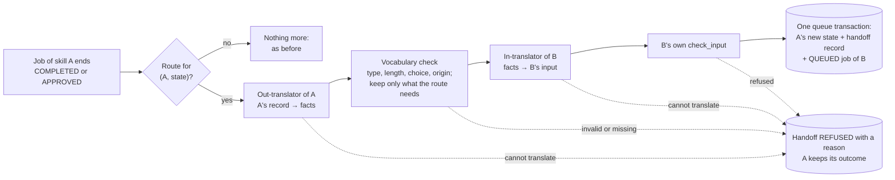

# Skill handoff: separate skills, one exchange, a translator on the way

**Status (2026-11-11):** built (roadmap [H1–H3 and H5's page part](ROADMAP.md#skill-handoff-track-h1h5), ADR-030 in
[architecture.md](architecture.md#8-architecture-decisions-adrs)), on the branch of its pull request; not merged or
deployed yet.
- The owner asked for it on 2026-11-11: each skill stays separate, work passes between skills through a
  go-between, and on the way a translator turns the data into the receiving agent's own language. The owner first
  got the design, then asked for it to be built and shown working, and for it to be tested with a new suite and
  with the existing ones.
- The first route is roadmap 2.3: an approved `case_triage.v2` case hands on to `case_triage.v2.apply`, which
  records where the case goes with a Core receipt. No Core file changed.
- Not built yet: the first new skill (H4, the owner chooses it) and the link between the two jobs' traces (H5).
- The same day the owner paused new work on the study guide (roadmap Phase 3, E4 and E6). This work does not
  need it and does not edit it: no route starts from it.
- Evidence: [the first runs](evidence/2026-11-11-skill-handoff.md) (all 217 existing triage cases end to end, the
  container smoke test, the page).

## ภาพรวมสำหรับเจ้าของโปรเจกต์

**สรุป:** ทักษะแต่ละด้านของระบบแยกขาดจากกันแล้ว และส่งงานให้กันผ่านตัวกลาง (exchange) เท่านั้น ระหว่างทางมีล่าม
(translator) แปลงข้อมูลเป็นภาษาของทักษะปลายทาง เส้นทางแรกใช้งานจริงแล้ว: เมื่อคุณกด "อนุมัติ" เคส ตัวกลางจะส่งเคสต่อให้งาน
"บันทึกผลหลังอนุมัติ" ทันที

**ภาพเปรียบ**
- **ทักษะ** คือห้องทำงานที่แยกกัน แต่ละห้องพูดภาษาของตัวเอง (แบบฟอร์มข้อมูลของตัวเอง) และไม่รู้จักห้องอื่น
- **ตัวกลาง** คือไปรษณีย์กลาง มีตารางเส้นทาง (route table) ที่เขียนไว้ล่วงหน้าว่าห้องไหนส่งงานให้ห้องไหนได้
- **ภาษากลาง** คือแบบฟอร์มกลางที่ไปรษณีย์ใช้ (common language) มีสมุดคำศัพท์กลาง (vocabulary) ที่มีเลขรุ่น
- **ล่าม** คือคนแปลประจำประตูของแต่ละห้อง
  - ล่ามขาออก แปลภาษาของห้องเป็นภาษากลาง
  - ล่ามขาเข้า แปลภาษากลางเป็นภาษาของห้องปลายทาง ตรงกับ "ตัวแปลงที่ดักไว้ก่อน" ที่คุณเล่า

**เมื่อคุณกด "อนุมัติ" เกิดอะไรขึ้น (ทีละขั้น)**
1. ตัวกลางเปิดตารางเส้นทาง เจอเส้นทาง "เคสที่อนุมัติแล้ว → บันทึกผลหลังอนุมัติ"
2. ล่ามขาออกแปลเคสเป็นภาษากลาง ข้อมูลทุกชิ้นติดป้ายว่ามาจากไหน
   - คนพิมพ์เข้ามา (input), โค้ดหรือกฎ (rules), คนตัดสิน (person) หรือ AI (ai)
3. ตัวกลางตรวจทุกชิ้นกับสมุดคำศัพท์กลาง แล้วเก็บไว้เฉพาะที่เส้นทางนี้ต้องใช้
   - ข้อความเคสที่คุณพิมพ์ และความเห็นของ AI ไม่ถูกส่งต่อ เพราะงานปลายทางไม่ต้องใช้
4. ล่ามขาเข้าแปลเป็นภาษาของงานปลายทาง แล้วข้อมูลต้องผ่านด่านตรวจประตูของงานนั้นเอง
5. ระบบบันทึกการตัดสินของคุณ การส่งต่อ และงานใหม่ ในครั้งเดียว (one transaction)
   - ถ้าเครื่องดับกลางทาง จะไม่มีอะไรค้างครึ่ง ๆ กลาง ๆ
   - กดซ้ำ 16 ครั้งพร้อมกันก็ได้งานใหม่แค่ 1 งาน
6. ตัวรันงานทำงานใหม่: บันทึกว่าเคสไปคิวไหน ใครอนุมัติ และรหัสการตัดสิน พร้อมใบรับ (receipt) จาก Core ไม่ส่งอะไรออกนอกระบบ
7. ถ้าแปลไม่ได้ในขั้นไหน ระบบไม่เดา: บันทึกว่า "ส่งต่อไม่ได้" พร้อมเหตุผล ส่วนการอนุมัติของคุณยังอยู่

**กติกาที่ยังอยู่ครบ**
- ไม่แตะ Core (แกนกลางของระบบ)
- AI ไม่เลือกเส้นทาง: ตารางเส้นทางเขียนไว้ล่วงหน้าและมีเลขรุ่น ข้อมูลที่มาจาก AI เป็นแค่ข้อมูล
- ล่ามเป็นโค้ดธรรมดา ไม่ใช่ AI จึงตรวจได้และทดสอบได้ และทุกตัวมีเลขรุ่น
- ไม่อนุมัติ = ไม่ส่งต่อ
- คนข้างนอกสั่งงาน "บันทึกผลหลังอนุมัติ" ตรง ๆ ไม่ได้ (ระบบตอบว่าไม่รู้จักงานนี้)
- ส่งต่อเป็นทอด ๆ ได้ไม่เกิน 3 ทอด และวนกลับมาที่เดิมไม่ได้

**ทำไมใช้ภาษากลาง แทนล่ามแยกทุกคู่**

| จำนวนทักษะ | ล่ามแยกทุกคู่ (ไปและกลับ) | ภาษากลาง (ทักษะละ 2 ตัว) |
|---|---|---|
| 3 | 6 | 6 |
| 5 | 20 | 10 |
| 10 | 90 | 20 |

**ทดสอบอย่างไร**
- ชุดทดสอบใหม่ 37 ข้อ: ภาษากลาง ล่าม ตารางเส้นทาง เหตุผลที่ส่งต่อไม่ได้ครบ 6 แบบ กดซ้ำพร้อมกัน เครื่องดับกลางทาง
  การอัปเกรดฐานข้อมูล และการตรวจว่าแต่ละทักษะไม่เรียกโค้ดของทักษะอื่น
- ทดสอบกับชุดเคสเดิมทั้ง 3 ชุด (217 เคส): ทุกเคสวิ่งครบสายจริง แล้วอนุมัติหรือไม่อนุมัติตามรูปแบบที่กำหนด ผ่านทุกข้อ
- ชุดทดสอบเดิมทั้งหมด ข้อสอบคัดแยกเคส ข้อสอบผู้ช่วยแนะนำแหล่งเรียน และด่านความทนทาน ได้ผลเหมือนเดิมทุกข้อ

**ดูการทำงานได้ที่ไหน**
- ตอนนี้ (ก่อนรวมโค้ด): เปิด PR → แท็บ Checks → *Core logic tests* → หน้าสรุป (Summary) จะเห็น
  "การส่งต่อระหว่างทักษะ: ตัวอย่างทีละขั้น" และตาราง "ทดสอบกับชุดเคสเดิม"
- หลังรวมโค้ดและ Render อัปเดตแล้ว: ลองบนหน้าเว็บจริงตามขั้นตอน "ลองบนหน้าเว็บ" ด้านล่าง

**ลองบนหน้าเว็บ (หลังรวมโค้ด)**
1. ส่งเคสตัวอย่าง เช่น "ถูกหักเงินซ้ำ" รอจนขึ้น "รอคนตรวจ"
2. ในการ์ด "ตัดสินเคสนี้" ต้องเห็นบรรทัดบอกว่า "ถ้าอนุมัติ ตัวกลางจะส่งต่อให้ …" แล้วกด "อนุมัติ" ใส่เหตุผล กดบันทึก
3. ใต้เคสต้องเห็นกล่อง "ส่งต่อแล้ว" บอกทีละขั้นว่าล่ามแปลอะไร ข้อมูลแต่ละชิ้นมาจากไหน และอะไรไม่ถูกส่งต่อ
4. กด "เปิดงานที่ส่งต่อไป" ต้องเห็นงาน "บันทึกผล …" ที่ "เสร็จแล้ว" บอกคิวที่อนุมัติ และกล่อง "งานนี้ถูกส่งต่อมาผ่านตัวกลาง"
5. กดบันทึกการตัดสินซ้ำไม่ได้แล้ว (ตัดสินแล้วแก้ไม่ได้) และรายการด้านซ้ายต้องมีงาน "บันทึกผล" แค่ 1 งานต่อเคส

**ผู้ช่วยแนะนำแหล่งเรียน: หยุดพัฒนาไว้ก่อน (11 พ.ย. 2026)**
- ของที่สร้างแล้วยังใช้ได้บนหน้าเว็บเหมือนเดิม และช่องตรวจอัตโนมัติของมันยังรันทุกครั้ง
- งานที่วางไว้ของมันหยุดก่อน: E4 และ E6
- งานนี้ไม่แก้ตัวผู้ช่วยเลย

**สิ่งที่คุณเลือกได้ต่อไป**
- ทักษะใหม่ตัวแรก (H4) เช่น "ร่างข้อความตอบลูกค้า" ที่รับงานต่อหลังคุณอนุมัติเคส (เป็นแค่ร่างให้คนอ่าน ไม่ส่งออกไปไหน)

## 1. Goal and terms

**Goal:** add skills without tying them together. A skill can be changed, versioned and tested alone; work moves
from one skill to the next only along a route written down in advance, and every move is checked and recorded.

| Term | Meaning here |
|---|---|
| Skill | One workflow type in the catalog (`app/services/workflows.py`), with its own domain under `app/domains/`: its input contract, trusted agents and fixed DAG. Today: `case_triage.v2`, `case_triage.v1`, `study_guide.v1`, and the route-only `case_triage.v2.apply` |
| A skill's language | The input its `check_input` accepts and the result its final step returns. Each skill keeps its own |
| Common language | One versioned envelope (`handoff-envelope-v1`) that carries *facts* from a versioned vocabulary (§3). Only the exchange reads and writes it |
| Translator | Pure, versioned code at one side of the common language: an *out*-translator turns a skill's result into facts, an *in*-translator turns facts into a skill's input (§4) |
| Route | One line of a versioned route table: from which skill, in which state, to which skill, through which translators (§5) |
| Exchange | `app/exchange/`: applies routes, runs translators and prepares the next job (§6) |
| Handoff | One use of a route for one source job, recorded in the handoff ledger, started or refused (§7) |

Names elsewhere for the same ideas: a mediator or message bus (the exchange), a message translator or adapter (the
translators), a canonical data model (the common language), a bounded context (a skill), an anti-corruption layer
(an in-translator that keeps a skill's own model clean), a transactional outbox (writing the next job in the same
transaction as the state change, §6).

## 2. How a handoff works



1. A source job reaches a state a route may start from: `COMPLETED` (an informational skill, ADR-018) or
   `APPROVED` (a person's decision, ADR-027). No other state starts a handoff: not `REVIEW_REQUIRED`, `REJECTED`,
   `FAILED`, `DELIVERY_FAILED` or `CANCELLED`.
2. The exchange looks up the route for that workflow type and state. With none, nothing else happens.
3. The source's out-translator reads only what the queue database holds for that job (its input, its result, and
   for `APPROVED` the decision row) and returns facts.
4. The exchange checks every fact against the vocabulary, refuses a fact the translator did not declare, and keeps
   only the facts the route needs (`left_out` lists the rest).
5. The target's in-translator turns the kept facts into the target's input, and the target's own `check_input`
   must accept it, exactly as for a request from outside.
6. The source's new state, the handoff record and the target's `QUEUED` job commit in one transaction.
7. Any refusal on the way is recorded with a reason code, and the source's outcome stays as it is.

## 3. The common language

### 3.1 The envelope

What the first route carries (from a real run; ids shortened):

```json
{
  "envelope": "handoff-envelope-v1",
  "route": "triage-approved-to-apply",
  "routes": "routes-v1@sha256:7a21675c…",
  "vocabulary": "vocabulary-v1@sha256:d4d25e07…",
  "source": {"job_id": "job_…", "workflow_type": "case_triage.v2", "state": "APPROVED", "result_sha256": "…"},
  "out": "out.case_triage.v2@1",
  "depth": 1,
  "facts": {
    "case.id": {"value": "DEMO-HANDOFF-1", "origin": "input"},
    "case.final_category": {"value": "billing", "origin": "person"},
    "case.final_queue": {"value": "billing_review", "origin": "person"},
    "review.decision_id": {"value": "dec_…", "origin": "person"},
    "review.reviewer_role": {"value": "owner", "origin": "person"}
  },
  "left_out": ["case.second_opinion", "case.suggested_category", "request.text"]
}
```

- It is plain JSON within Core's message rules, and its SHA-256 is Core's canonical `fingerprint`
  (`envelope_sha256` in the ledger).
- `depth` counts handoffs since the request from outside: a job admitted from outside is depth 0.
- It names versions, never code: route id, table and vocabulary hashes, translator ids with versions.
- The case text (`request.text`) and the AI's second opinion are given by the out-translator but not carried:
  this route does not need them (data minimisation).

### 3.2 Facts and the vocabulary

The vocabulary is versioned data, `app/exchange/vocabulary_v1.json`, with its complete SHA-256 in its tag, like
`keywords_v2.json` (E2). Each fact name has a type (`text` with a maximum length, `choice` with fixed values, or `id`
with a pattern), the origins it may come from, and its meaning in English and Thai. A name keeps its meaning
forever; a new meaning is a new name, and any change to the file is a new vocabulary version.

| Fact | Type | Origins | Meaning |
|---|---|---|---|
| `request.text` | text, 1–500 characters | `input` | The words a person typed, such as a case summary |
| `case.id` | id (the case contract's pattern) | `input` | The case's own id |
| `case.suggested_category` | choice: the four categories | `rules` | The category the keyword rules suggested |
| `case.second_opinion` | choice: the four categories | `ai` | The category the AI gave as a second opinion |
| `case.final_category` | choice: the four categories | `person` | The category a person approved |
| `case.final_queue` | choice: the four review queues | `person` | The queue of the approved category |
| `review.decision_id` | id (`dec_` + 24 hex) | `person` | The decision a person recorded |
| `review.reviewer_role` | choice: `owner` | `person` | Who decided: today only the owner (ADR-027) |

### 3.3 Where each fact comes from

| Origin | Who produced it | What it may be used for |
|---|---|---|
| `input` | A person, through the API or the page | Copied into the target's input. Its text is masked before any AI call, as all input is (ADR-028) |
| `rules` | Code: rules, library picks, fixed mappings | Copied into the target's input |
| `person` | A reviewer's decision (ADR-027) | Copied into the target's input |
| `ai` | A model's answer, after its validators passed | Data only. It can never stand in for another origin (the vocabulary refuses `case.final_category` from `ai`), and no route depends on it |

A value derived by code from another fact keeps that fact's origin: the queue mapped from a reviewer's category is
`person`.

## 4. Translators

- **Where:** `app/exchange/translators/`, one module per skill, outside `app/domains/`. A skill does not know the
  exchange exists, so no skill is edited to join a route.
- **Pure code:** no AI, no network, no files, no clock, no randomness. The same input always gives the same
  output, so a translation repeated after a crash gives the same envelope.
- **Contract:**
  - out: a `SourceView` (workflow type, state, input, result, decision) → facts, reading only what the queue
    database holds (ADR-001: never Core's files); it raises `SourceIncomplete` instead of guessing;
  - in: facts → its skill's input, which then must pass that skill's own `check_input`.
- **Versioned:** each translator has an id and a version (`out.case_triage.v2@1`), recorded in every handoff. A
  change in what a translator returns is a new version; `tests/test_exchange.py` pins each one's output.
- **Isolation, tested:** no module under `app/domains/<skill>/` imports another skill, the exchange, the services,
  the API or the queue; a translator imports only its own skill's fixed vocabulary (`contracts.py`).

Built: `out.case_triage.v2@1` (from `APPROVED`) and `in.case_triage.v2.apply@1`. There is no translator for the
study guide: no route needs one, and it is paused.

## 5. Routes

The route table is versioned data, `app/exchange/routes_v1.json`, with its complete SHA-256 in its tag. Today it
holds one route:

```json
{"id": "triage-approved-to-apply",
 "from": "case_triage.v2", "on": "APPROVED", "to": "case_triage.v2.apply",
 "out": "out.case_triage.v2@1", "in": "in.case_triage.v2.apply@1",
 "needs": ["case.id", "case.final_category", "case.final_queue", "review.decision_id", "review.reviewer_role"],
 "why": {"en": "Record where an approved case goes, with a Core receipt (roadmap 2.3)", "th": "…"}}
```

Checked when the API and the Runner start (`Exchange(catalog)`), and by tests on the committed file:
- the shape: known fields, an id that fits the target's idempotency key, `on` is `COMPLETED` or `APPROVED`, needs
  distinct and not empty, `why` in English and Thai, `max_depth` 1–3;
- against the process: the target is in the catalog; at most one route per `(from, on)`; the out-translator is an
  out-translator of the source for that state, the in-translator one of the target; `needs` are in the vocabulary,
  the out-translator can give them, and they cover every fact the in-translator reads; no cycle.

A table that does not fit raises `ExchangeConfigError`, so the process does not start; it is never half-applied.
A route whose source the process does not run is skipped (test catalogs).

**Skills only a route may start.** `case_triage.v2.apply` is marked `route_only` in the catalog. `POST /v1/jobs`
refuses it (`400 unknown_workflow_type`, as for any type outside the frame, and its `allowed` list leaves it out),
so nobody can start it from outside with made-up decision facts (rule 7).

**Which table applies.** The one in force at the source's state change; its hash is recorded in the handoff. A
person approving a case sees on the decision card what the approval will start. A source job is never handed off
twice, so a later table cannot add a second handoff to an old job.

## 6. The exchange: where a handoff happens

| Source state | Who changes it | Where the handoff is written |
|---|---|---|
| `COMPLETED` | The Runner, when it records the outcome (`QueueStore.finish`) | In `finish()`'s transaction |
| `APPROVED` | The reviews service, on a person's decision (`QueueStore.decide`) | In `decide()`'s transaction, after the decision row, so the facts carry its id |

Both calls take `handoff=exchange.prepare`. The store runs it inside its own transaction on the job's new record
(and the decision row); `prepare` is pure and quick, and it returns a plan or `None`. A `STARTED` plan inserts the
target's `QUEUED` job and the `handoffs` row; a `REFUSED` plan inserts the row with its reason and no job.

- **Exactly one target job.** The target's idempotency key is `handoff:<source_job_id>:<route_id>`, and the ledger
  allows one row per source job and route. A retried click returns the same decision and the same handoff; a
  Runner that crashed after Core finished reconciles, finishes again in one transaction, and hands on once.
- **The queue limit.** A handoff is not refused because the queue is full: its source was admitted under the
  limit, a job ends in only one state so it starts at most one handoff, and chains stop at the table's depth.
- **No Core change, and Core stays the Runner's alone.** The exchange reads and writes only the queue database
  (ADR-001). The target job is an ordinary Core job with its own frozen spec, versions and receipt.
- **ADR-002 still holds.** The target's queue row is committed together with the change that caused it.

## 7. What is recorded and shown

**Ledger:** a `handoffs` table in the queue database (schema 3; a version-2 database is upgraded at start, tested):
handoff id (`hof_` + 24 hex), route id, the route table's and the vocabulary's tags, both translator versions, the
source job and state, the target type and job id (none when refused), depth, state `STARTED` or `REFUSED`, the
reason and error type, the envelope and its SHA-256, and the time. Unique: (source job id, route id) and the
target job id; a `STARTED` row always has a target and a `REFUSED` row never does.

**Events:** the source gets `handoff.started` (route, handoff id, target job id and type) or `handoff.refused`
(route, reason code); the target's `job.queued` event carries the handoff id, route id and source job id. Events,
logs and errors carry ids and codes only, never fact values: a fact can hold case text (rule 6).

**API:** `GET /v1/jobs/{job_id}` has `handoff: {from, to}`; a `text` fact shows only its length. `GET /v1/jobs` gives
`from_job_id`. A decision's reply lists `handoffs`. `/v1/status` lists the routes in plain words with the fact
meanings, the refusal codes, the versions and counts; each workflow says `route_only`. Details:
[intake_queue.md](intake_queue.md#api-reference).

**Page:** an approved case shows "ส่งต่อแล้ว" with each step (out-translator, the facts with their origins, what was
left out, the in-translator) and a button to the job it started; that job shows "งานนี้ถูกส่งต่อมาผ่านตัวกลาง" with a
button back; a refused handoff shows its reason in Thai; the decision card says what an approval will start; the
event history names the handoff. `tests/test_web_page.py` holds the new tables to `app/exchange`.

**Not built yet:** a link between the source's and the target's traces in Honeycomb (H5). The target job has its
own trace today.

**Retention:** the same as every queue record: on the free plan, handoffs vanish on sleep, restart and deploy
(ADR-029, D1).

## 8. Failure and refusal

Refusing a handoff never undoes or fails the source job: its outcome is already true. The refusal is recorded
beside it and shown, with its reason code.

| What goes wrong | What happens |
|---|---|
| The source's record lacks what the out-translator needs (for example, no proposal) | `REFUSED`, `source_incomplete` |
| A fact breaks the vocabulary (type, length, choice, origin) or was not declared by its translator | `REFUSED`, `fact_invalid` |
| A fact the route needs is missing | `REFUSED`, `fact_missing` |
| The target's `check_input` refuses the translated input | `REFUSED`, `target_input_invalid` |
| The chain would go past `max_depth` | `REFUSED`, `chain_too_long` |
| A translator raises an unexpected error | `REFUSED`, `translator_error` (its type only) |
| The route table does not fit the catalog | The API and the Runner do not start (§5) |
| A failure inside the transaction (for example the disk) | Nothing is written: no decision, no handoff, no job; the same click again works |
| A crash before the commit | Nothing is written. The Runner reconciles and finishes again; a person's click is retried with the same key |
| A crash after the commit | The target job is `QUEUED`; nothing needs redoing |

Retrying a refused handoff by hand after a fix is not built: it would be a person's action on a recorded refusal,
so it gets its own decision first.

## 9. How it keeps the rules

| Rule (CLAUDE.md §3) | How |
|---|---|
| 1 Core unchanged | Only `app/`: `app/exchange/`, the apply skill in `app/domains/case_triage/apply.py`, the queue schema, the Runner's and the reviews service's transactions, the API and the page |
| 2 Only the Runner opens `Runtime` | The exchange uses the queue database only |
| 3 Reply after commit; one machine, SQLite | The target job is written in the same SQLite transaction; no broker |
| 4 AI proposes, code validates, people decide | Routes are fixed, versioned data; an `ai` fact cannot pose as another origin and routes nothing; translators are code; the first route starts only after a person approved; the apply job records the person's decision and cannot change it (its validator) |
| 5 Trusted, versioned agents | The apply agent is in the registry (`triage.apply`, version `apply-1`); the route table, vocabulary and translators are versioned and recorded per handoff |
| 6 Secrets and logs | The envelope never holds a key; events and logs carry ids and codes only; the case text is not carried |
| 7 Outside requests name only a `workflow_type` | Outside requests cannot name a route, a translator or a handoff, and route-only skills are refused at admission |
| 8 Standard library first | JSON files, `sqlite3`, `hashlib`; no new dependency |
| 9 Synthetic data only | Unchanged; all test data is synthetic |
| 10 No P2 items | Each job stays a static DAG; the chain lives in the application layer (pattern B's linked job), on one machine |

## 10. Not in the first version

- Conditions on a route (for example "only when the category is `access`"). When needed, with a new ADR, a
  condition may read only `choice` facts whose origin is `rules` or `person`.
- More than one route per skill and state (fan-out), or one job built from several sources (fan-in).
- AI translators.
- A route chosen per request, or any outside caller starting a handoff.
- Targets with side effects outside the system (roadmap 2.6 first).
- Handoffs from `REJECTED`, `FAILED`, `DELIVERY_FAILED` or `CANCELLED`.
- A translator for the study guide (paused; no route needs it).

## 11. Alternatives considered

| Alternative | Why not now |
|---|---|
| Skills call each other directly (one imports the other's agents) | Fastest to build, but a change in one breaks the other, and the study guide would need edits while it is paused |
| A translator for every pair (what the owner first described) | Fine for two skills; grows as N × (N − 1). The common language keeps the owner's translator at the receiving door (the in-translator) |
| One bigger workflow with both skills' steps in one Core job | One receipt, but each skill's DAG becomes part of another's, the catalog needs a type for every combination, and a shape that depends on a result is pattern C (P2) |
| An AI translator | Its output would need the same checks anyway, it costs a call per handoff, and it could move a person's words into the wrong field. Deferred until a route needs it, with its own ADR |
| Translators inside each skill | Common elsewhere, but it edits every skill and makes each one know the exchange. Revisit if the exchange's translators drift from their skills despite the tests |
| A message broker (Redis, RabbitMQ, Kafka) | ADR-003 and the P2 list: one machine and SQLite. The queue database already gives a durable outbox |

## 12. Build plan and status

The packages and what each needs are also in [ROADMAP.md](ROADMAP.md#skill-handoff-track-h1h5).

| Package | Content | Status |
|---|---|---|
| H1 | This design and ADR-030 | ✅ the owner read it and asked for it to be built (2026-11-11) |
| H2 | `app/exchange/`: envelope, vocabulary and its hash, the `Translator` type, `out.case_triage.v2@1`, `in.case_triage.v2.apply@1`, isolation tests, golden outputs | ✅ built and tested |
| H3 | The route table and its checks, queue schema 3 and the `handoffs` table, the handoff inside `finish()` and `decide()`, events, the API fields, and `case_triage.v2.apply` (roadmap 2.3), refused at `POST /v1/jobs` | 🟡 built and tested (P0 gate "approval creates exactly one phase-B job" met); the owner's test on the live page after the merge is left |
| H4 | The first new skill the owner chooses, as its own domain, joined only through translators and one route | ⬜ waits for the owner's choice |
| H5 | The chain on the page (built) and a link between the two jobs' traces (not built) | 🟡 |

## 13. How it is tested

| What | Where | Result on 2026-11-11 |
|---|---|---|
| The language, translators (golden outputs), route checks, every refusal code, admission, isolation | `tests/test_exchange.py` | 22 tests pass |
| Queue, Runner and API: end to end, rejection, the same click again, 16 identical clicks at once, 16 different decisions at once, a failure inside the transaction, a refused handoff, a Runner crash before the commit, the depth limit, `/v1/status`, a forged request, the 2 → 3 upgrade, the owner demo | `tests/test_service_handoff.py` | 14 tests pass |
| The page's tables and links | `tests/test_web_page.py` | 1 new test passes |
| Every case of the three triage sets (61 development, 40 held-out, 116 edge) end to end: approve as proposed, approve with another category, or reject; then the same click again | `python -m tests.handoff_check`, in *Core logic tests* | 217 cases, 0 problems, 16 s |
| One case step by step, on the run page | `python -m examples.skill_handoff_demo`, in *Core logic tests* | passes |
| The built container: an approval hands on, the apply job completes with a receipt, a forged request is refused, all of it survives a restart | `examples/service_smoke_test.py`, in *Service container* | passed against a local server; CI runs it in the container |
| All earlier tests, both eval gates and the robustness gate | as before | unchanged outcomes |

The mock AI only shapes the proposals in these runs; the exchange and its translators use no AI, so a live model
would not change what they do.

## 14. Further reading

From the verified study library (checked every Monday by *Study library link check*):
1. Anthropic, [Building effective agents](https://www.anthropic.com/research/building-effective-agents): how agents
   pass work along (prompt chaining, routing, orchestrator-workers). Start here; it is the shortest.
2. Anthropic, [Equipping agents for the real world with Agent Skills](https://www.anthropic.com/research/equipping-agents-for-the-real-world-with-agent-skills):
   skills as separate packages, loaded when needed.
3. [roadmap.sh System Design](https://roadmap.sh/system-design): a map; read its messaging part, skip scaling
   across machines for now.

Not linked, because this session could not open the site to check the address: Hohpe and Woolf, *Enterprise
Integration Patterns*, the patterns *Message Translator* and *Canonical Data Model*, the origin of the translator
and the common language used here. Each is one short page; search for the pattern's name.
